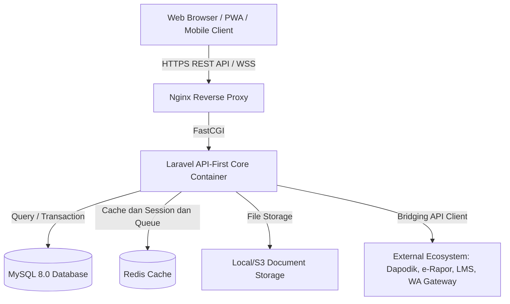
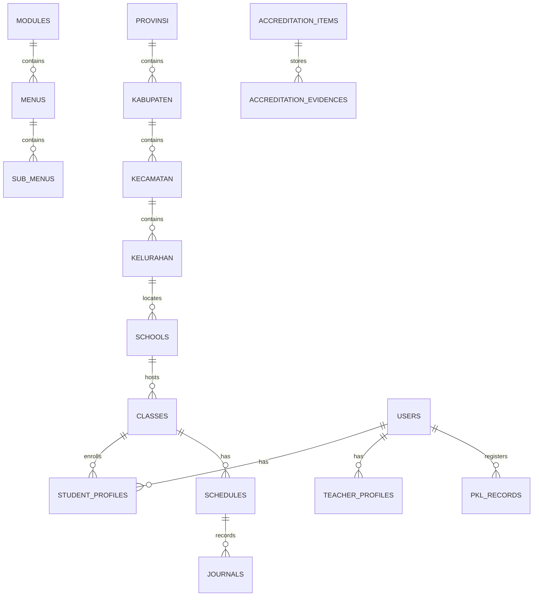

# 🎨 INFORA Design dan Architecture Specification
> **Information Network for Organization, Records, dan Accreditation**  
> *"Era Baru Sistem Informasi Sekolah Menengah (SMA, SMK, dan MA)"*

---

## 1. 🌟 Ringkasan Eksekutif (Executive Summary)

**INFORA** adalah platform web Sistem Informasi Manajemen (SIM) sekolah menengah modern berbasis cloud yang dirancang untuk **SMA**, **SMK**, dan **Madrasah Aliyah (MA)**. INFORA menghadirkan ekosistem terpadu yang mengintegrasikan tata kelola akademik, kesiswaan, kepegawaian (GTK), hubungan industri dan magang PKL (khusus SMK), hingga otomasi pemenuhan instrumen akreditasi sekolah unggul (BAN-SM / IASP).

---

## 2. 🎨 Identitas Visual dan Desain Sistem (Brand dan UI/UX System)

### 2.1. Brand Identity
- **Nama Platform:** INFORA
- **Tagline:** Era Baru Sistem Informasi Sekolah Menengah
- **Brand Personality:** Modern, Sleek, Intelligent, Reliable, Student dan Teacher Friendly.

### 2.2. Palet Warna (Color Palette - Light, Friendly dan High-Readability)
| Token | Kode Warna | Penggunaan |
| :--- | :--- | :--- |
| **Canvas Background** | `#F8FAFC` (Slate 50) | Latar belakang kanvas aplikasi yang tenang, sejuk, dan tidak menyilaukan |
| **Primary Surface** | `#FFFFFF` | Permukaan Card, Sidebar, Topbar, dan Elemen Konten Bersih |
| **Muted Surface** | `#F1F5F9` (Slate 100) | Secondary Button, Input Background, Area Hover Subtil |
| **Border / Divider** | `#E2E8F0` (Slate 200) | Garis batas komponen yang presisi, halus, dan elegan |
| **Brand Primary** | `#2563EB` (Royal Blue) | Tombol Utama, Identitas Brand Institusi, Highlight Utama |
| **Brand Cyan / Sky** | `#0284C7` (Sky Blue) | Gradien Aksen Brand (`#0284C7` ke `#2563EB`), Indikator Aktif |
| **Brand Soft Tint** | `#EFF6FF` (Blue 50) | Latar menu navigasi aktif, chip badge, dan seleksi data |
| **Success Emerald** | `#16A34A` / `#F0FDF4` | Status Verifikasi, Validasi Dokumen, Akun Aktif |
| **Warning Amber** | `#D97706` / `#FFFBEB` | Peringatan Kelengkapan Dokumen, Keterlambatan |
| **Danger Rose** | `#DC2626` / `#FEF2F2` | Pelanggaran Disiplin, Pesan Error, Peringatan Sistem |
| **Text Primary (Readability)** | `#0F172A` (Slate 900) | Teks Utama dengan kontras tajam (WCAG AAA) mudah dibaca guru dan siswa |
| **Text Muted** | `#475569` (Slate 600) | Label Formulir, Sub-heading, Deskripsi Sekunder |
| **Text Dim** | `#64748B` (Slate 500) | Metadata, Placeholder, Timestamp |

### 2.3. Tipografi
- **Headings dan Display:** `Plus Jakarta Sans` (Modern, geometric, tegas, ramah, dan bersahabat bagi sivitas sekolah).
- **Body dan Data Tables:** `Inter` / `Plus Jakarta Sans` (Tingkat keterbacaan tinggi untuk tabel nilai, jurnal KBM, dan berkas akreditasi).
- **Monospace (ID Siswa/NISN/Kode):** `JetBrains Mono` / `Fira Code`.

### 2.4. Prinsip UI/UX dan Arsitektur Layout
1. **Nuansa Terang, Halus dan Bersih (*Bright, Smooth dan Clean*):** Antarmuka dirancang dengan latar terang yang menyejukkan mata (*eye-friendly*), transisi halus, serta sangat ramah bagi penggunaan harian guru dan siswa tanpa memicu kelelahan visual (*visual fatigue*).
2. **Keterbacaan Tinggi (*High Readability*):** Mengutamakan ketajaman teks dengan rasio kontras tinggi antara teks gelap (`#0F172A`) dan latar bersih (`#FFFFFF`/`#F8FAFC`), memudahkan guru senior membaca formulir dan rekap data.
3. **Dedicated Layout Separation (Desktop vs Mobile):** Menggunakan pemisahan master layout secara terpisah (`layouts/desktop.blade.php` dan `layouts/mobile.blade.php`), bukan sekadar menyembunyikan elemen via CSS (`hidden md:block`). Pendekatan ini menjaga ukuran DOM tetap ramping dan interaksi terasa native.
4. **Mobile First Experience:** Antarmuka ponsel pintar dirancang dengan *bottom bar navigation*, ramah gestur sentuh (touch target minimal 44px), dan kecepatan interaksi instan (<300ms) untuk guru dan siswa.
5. **Desktop Power-Dashboard:** Menyajikan tata letak *high-density data* untuk staf administrasi, pimpinan sekolah, dan asesor akreditasi dengan *sidebar* navigasi fleksibel, tabel analitik bervolume besar, dan visualisasi grafik komprehensif.
6. **Reusable Global CSS Classes (Strict No Ad-Hoc Classes):** Seluruh styling antarmuka dikembangkan menggunakan nama class CSS global terstruktur dan reusable. Dilarang keras membuat class CSS khusus/ad-hoc sekali pakai, dilarang menggunakan *inline style* (`style="..."`), dan dilarang menyisipkan tag `<style>` di dalam berkas Blade view. Seluruh kustomisasi UI wajib didaftarkan sebagai class reusable melalui berkas stylesheet terpusat (`resources/css/`). Termasuk di dalamnya komponen universal: Dropdown (`.dropdown`, `.dropdown-menu`, `.dropdown-item`), Kartu Pengguna (`.user-card-button`), dan Modal Dialog (`.modal-backdrop`, `.modal-dialog`).
7. **Pemisah Modul Classic Minimalist:** Label modul berfungsi sebagai pemisah kategori yang rapi dan elegan (`.menu-category-label` dengan garis pembatas tipis atas dan tipografi uppercase) tanpa memerlukan opsi icon modul yang redundan.
8. **Seksi Profil Pengguna dan Dropup Popover di Sidebar Footer:** Profil pengguna dan aksi logout ditempatkan di bagian bawah sidebar (`.sidebar-footer`) menggunakan kartu interaktif (`.user-card-button`) yang memicu popover menu melayang ke atas (*dropup*) berisi Pengaturan Profile, Ubah Password, Bantuan, dan Keluar.
9. **Penjangkaran Simetris Animasi Sidebar (*Anchored Symmetrical Transition*):** Posisi avatar pengguna (17px margin) dan seluruh ikon menu (26px margin) dikunci secara permanen baik saat sidebar terbuka (260px) maupun ciut (72px). Menghindari penggunaan `justify-content: center` saat ciut untuk mencegah pergeseran horizontal (*0px horizontal jump*), serta menerapkan transisi kurva halus `opacity: 0.2s cubic-bezier(0.4, 0, 0.2, 1)` dan `transform: translateX(-10px)` pada teks judul menu, badge, dan panah accordion.
10. **Tombol Pencarian Interaktif Mode Ciut dan Shortcut Global (`Ctrl+K`):** Pada mode sidebar ciut (72px), kotak pencarian otomatis bertransformasi menjadi tombol ikon 40px x 40px yang bersih dan responsif di atas menu Dashboard. Mengklik tombol ini otomatis memperluas sidebar ke 260px dan memfokuskan input pencarian. Didukung shortcut global `Ctrl+K` atau `/`.
11. **Universal Smooth Progressive Loading Screen (`window.InforaProgress` dan `<x-progress-modal />`):** Sistem indikator loading global terpadu yang dapat dipanggil oleh seluruh modul platform. Desain minimalis tanpa elemen kaku dengan kartu melayang ber-backdrop blur, ambient status orb berdenyut lembut, judul dan teks aktivitas ringkas dinamis, serta bar progres ramping (9px) dengan sapuan gradien bercahaya (*ambient gradient shimmer*) yang bergerak sangat halus (*buttery smooth*).
12. **Arsitektur Dialog Modal Flexbox dan Spacing Standard:**
    - Seluruh dialog modal menggunakan struktur flex column `.modal-dialog form { display: flex; flex-direction: column; flex: 1; min-height: 0; }` dengan `.modal-header` dan `.modal-footer` terproteksi `flex-shrink: 0`, menjamin tombol aksi tidak pernah terpotong (*zero-clipping sticky footers*) pada ketinggian layar apa pun.
    - Area `.modal-body` memanfaatkan *dynamic vertical scroll* dengan *custom slim scrollbar* (6px) dan normalisasi margin input (`.modal-body .form-group { margin-bottom: 0; }`) untuk mencegah penumpukan jarak ganda.
    - Pembatas seksi form `.form-section-divider` menggunakan warna border standar sistem desain (`border-top: 1px solid var(--infora-border)`), dipadukan dengan label seksi edukasi `.form-section-label` berformat badge khas INFORA dengan indikator titik biru.
13. **Arsitektur Modal Dialog CRUD Modular (Create dan Edit as Components in Index, Zero Standalone Edit Pages):**
    - Seluruh formulir Tambah (`create`) dan Ubah (`edit`) pada entitas administratif (Data Sekolah, Modul, Menu, Sub-Menu, serta Wilayah Administratif) terintegrasi langsung sebagai modal dialog interaktif di atas halaman `index`, menghilangkan keharusan berpindah atau redirect ke halaman baru (*zero-reload workflow*).
    - Berkas `create.blade.php` dan `edit.blade.php` distandarisasi sebagai komponen Blade modular yang di-include (`@include('...create')`, `@include('...edit')`) ke dalam `index.blade.php`, bukan lagi berupa view terpisah yang meng-`@extends('layouts.app')`.
14. **Pengaturan Profil Pengguna Mandiri & Keamanan Akun (`/profile`):**
    - Arsitektur tata letak 2-kolom (`.grid-split-sidebar`): Navigasi tab vertikal di kiri (`.tab-pills-vertical`) dan panel formulir di kanan.
    - Struktur tab dinamis adaptif: 4 tab untuk pendidik/tendik GTK (*Informasi Pribadi*, *Klasifikasi & Pendidikan*, *Kontak & Domisili*, *Status Keaktifan*) dan 2 tab untuk non-GTK (*Informasi Pribadi*, *Status Keaktifan*).
    - Konsolidasi Informasi Pribadi: Menggabungkan pasfoto avatar circular (`<x-image-upload>`), identitas/biodata diri, input username login, dan kartu formulir ubah kata sandi terpisah.
    - Proteksi Integritas Data & Form Dirty Tracking: Mendeteksi input yang belum disimpan saat berpindah tab via modal konfirmasi (`modalConfirmUnsavedProfile`), serta alur auto-logout pasca pembaruan kata sandi demi keamanan sesi akun.
    - Integrasi data dinamis melalui tombol aksi edit dengan atribut `data-*` (seperti `data-school`, `data-module`, `data-menu`, `data-sub-menu`, `data-provinsi`, dll.) yang dibaca oleh listener JavaScript untuk mengisi input form modal secara instan.
    - Penanganan validasi server cerdas (*auto-reopen*) dengan deteksi `old('_method') === 'PUT'` (untuk modal edit) atau `$errors->any()` (untuk modal create), memastikan modal terbuka kembali secara otomatis saat terjadi kegagalan validasi backend dengan data input (`old(...)`) tetap terjaga.
    - Kompatibilitas rute: metode `Controller::edit()` mengalihkan (*redirect*) pengguna kembali ke `index` guna menjaga kompatibilitas rute dan bookmark.
14. **Arsitektur Antarmuka 3-Tier (Docked Footer dan Scroll Internal Independen):**
    - Membagi struktur tampilan aplikasi menjadi 3 zona layout: Topbar (*header*) tetap di bagian atas, footer *docked* permanen di bawah viewport layar (`.app-footer`), dan scrolling vertikal independen pada area konten utama (`.app-content`) dan navigasi sidebar (`.sidebar-content`).
    - Mengeliminasi *double scrollbar* pada window browser, menjaga footer sistem selalu terlihat rapi tanpa terdorong ke luar layar, dan mengunci `flex-shrink: 0` pada item navigasi sidebar agar teks menu tidak tertekan saat accordion dibuka.
15. **Komponen Paginasi Responsif Universal (`<x-pagination>`):**
    - Komponen paginasi global terstandarisasi di `resources/views/components/pagination.blade.php` dengan badge informasi rentang data adaptif, tombol navigasi sebelumnya/selanjutnya yang mobile-friendly, dan link nomor halaman ringkas.
    - Terdaftar secara global pada `AppServiceProvider` via `Paginator::defaultView('components.pagination')`.
    - Dipadukan dengan `.table-toolbar-responsive` untuk wrapping kontrol pencarian dan filter yang rapi, serta modifier `.table-responsive-scroll` dengan sticky header dan adaptasi tinggi responsif terhadap tinggi layar (`calc(100vh - 360px)` / flex container).
16. **Ekosistem 22 Komponen Blade UI dan Modul Client Terpadu (`InforaModals`, `SearchableSelect`, `ImageUpload`, `PermissionMatrix`, `InforaProgress`):**
    - Seluruh antarmuka mengadopsi Anonymous Blade Components yang terisolasi dan terdokumentasi lengkap di `docs/COMPONENTS.md`.
    - Menjamin pemisahan tampilan murni dari dependensi inline styles, mendukung formulir interaktif tanpa reload (*zero-reload workflow*), serta kontrol dinamis via controller JavaScript native.
17. **Standardisasi Service Mandiri `ImageUploader` dan Base64 Pipeline:**
    - Service backend murni PHP `App\Support\ImageUploader` yang menjamin sanitasi Data URI Base64, pembatasan ketat ukuran gambar maks 1MB (`DEFAULT_MAX_BYTES = 1048576`), validasi MIME type (`png`, `jpg`, `jpeg`, `webp`, `gif`, `svg`), dan pola penamaan semantik collision-proof `{modul}_u{user_id}_{timestamp}_{random8}.{ext}`.
18. **Pengendali Matriks Hak Akses Dinamis (`PermissionMatrix`):**
    - Modul JavaScript mandiri `resources/js/permission-matrix.js` untuk manajemen RBAC granular (View vs CRUD dependencies, parent-child menu synchronization, bulk select toolbar, dan per-module toggle).

### 2.5. Sistem Ikonografi dan Navigasi Hirarki (Iconography dan Route Resolution)
1. **100% Free dan Open-Source Lucide Icons:** Menggunakan keluarga ikon Lucide Icons resmi (lisensi open source ISC) berbasis SVG murni yang di-render native via komponen `<x-icon>`. Bebas biaya lisensi dan tanpa ketergantungan font eksternal.
2. **Visual Icon Picker Interaktif (`<x-icon-picker>`):** Formulir manajemen modul dan menu dilengkapi dialog katalog visual dengan live preview, pencarian kata kunci instan, dan tab filter kategori (Navigasi, Akademik, Data, Pengguna, Sistem, Wilayah, Umum) untuk meminimalisir kesalahan pengetikan manual.
3. **Perluasan Katalog Ikon Wilayah dan Data:** Koleksi ikon SVG resmi diperluas mencakup kategori Wilayah (`map`, `map-pin`, `landmark`, `building`, `building-2`, `globe`) dan kategori Data (`table`), mendukung modularitas modul wilayah dan tabel data.
4. **Sub-Menu Hirarki Rapi (Tanpa Bullet Dot):** Sub-menu sidebar menggunakan tata letak berjenjang bersih dengan *left accent indicator bar* pada hover dan status aktif, menggantikan titik peluru (*bullet dot*) konvensional agar tampilan lebih modern dan nyaman dipandang.
5. **Otomatisasi Urutan Tampil Mulai 1 dan Dual-Field Rute Sub-Menu:** Nilai urutan bawaan (`order`) pada tabel modul, menu, dan sub-menu dimulai dari 1 (menggantikan default 0). Model `Module`, `Menu`, dan `SubMenu` dilengkapi metode pembantu `nextOrder()` untuk mengisi nomor urut berikutnya secara otomatis. Formulir sub-menu mengadopsi input dual-field nama rute (prefix rute menu induk terkunci + input slug sub-rute mandiri) guna mencegah salah ketik.
6. **Resolusi Rute Otomatis (Hierarchical Route Pattern):** Pengguna cukup mendefinisikan rute dengan pola hierarki sederhana `modul.menu` atau `modul.menu.submenu`. Model secara cerdas mencocokkan ketersediaan rute terdaftar baik dengan akhiran `.index` maupun rute langsung, serta mendeteksi status aktif pada seluruh sub-halaman terkait tanpa membebani pengguna.
7. **Halaman Placeholder 'Fitur Dalam Pengembangan' (Zero Dead Links dan Developer Blueprint):** Jika suatu menu atau sub-menu memiliki `route_name` yang belum terdaftar di `routes/web.php` (atau masih kosong), sistem secara otomatis mengarahkan tautan ke rute terpusat `/system/under-development?type={menu|submenu}&id={id}` alih-alih merender link mati (`href="#"`). Halaman ini menyajikan status pengembangan, hierarki navigasi, kartu status operasional, serta cetak biru teknis bagi developer (snippet rute Laravel dan perintah `php artisan make:controller`). Navigasi sidebar secara cerdas mempertahankan status aktif dan membuka accordion induk ketika halaman placeholder ini dikunjungi.

---

## 3. 🏛️ Arsitektur Sistem dan Tech Stack

### 3.1. Core Stack
- **Architecture Pattern:** Modular Monolith (Domain-Driven Modules) dan API-First Bridging
- **Data Response Contract:** Strict Pure JSON (`application/json`), Eloquent API Resources (Zero HTML in Data Payloads)
- **Backend Framework:** Laravel (Versi Terbaru / Latest Version)
- **Frontend Stack:** Blade + Alpine.js / Vue.js + Vanilla CSS dan TailwindCSS (Mobile-First Architecture dan Dedicated Layouts)
- **Automated Testing Suite:** Pest PHP — **355 Tests Passed dan 1,668 Assertions (100% Pass Rate)**
- **UI Components:** 25 Anonymous Blade Components ([`docs/COMPONENTS.md`](../docs/COMPONENTS.md))
- **Database:** MySQL 8.0 / MariaDB
- **Caching dan Real-time Queue:** Redis (untuk antrian pemrosesan dokumen akreditasi dan notifikasi)
- **Containerization:** Docker dan Docker Compose (Nginx, PHP-FPM, MySQL, Node.js)

---

## 4. 👥 Manajemen Akun Sivitas dan User-Centric Menu Access

### 4.1. Empat Tipe Akun Utama (`user_type`)
Untuk menjamin integritas data dan keamanan, platform mengelompokkan pengguna ke dalam 4 tipe akun utama pada tabel `users`:
1. **`super_admin`:** Tim IT / Developer / Yayasan. Memiliki akses root (*bypass permission*), mengelola konfigurasi global, audit log, dan integrasi API bridging.
2. **`admin`:** Staf Tata Usaha (TU) / Operator Sekolah. Mengelola master data sekolah (Rombel, TA, Mapel), akun guru/siswa, plotting jadwal, dan alokasi menu guru.
3. **`guru`:** Pendidik dan Tenaga Pengajar. Dapat memegang tugas tambahan majemuk (Guru Mapel, Wali Kelas, Pembimbing PKL, Tim Akreditasi, Guru BK).
4. **`siswa`:** Peserta Didik Aktif (terhubung ke data orang tua). Mengakses informasi akademik, portofolio prestasi, dan jurnal mandiri PKL (SMK).

### 4.2. Arsitektur Basis Data: *Single User Table + 1-to-1 Profile Relations*
Menghindari kerumitan *multi-auth guard* dengan memusatkan otentikasi pada tabel `users` tunggal yang berelasi spesifik:
- `users` (id, name, username, email, password, user_type, is_active, avatar)
  - `student_profiles` (user_id, nisn, nis, rombel_id, angkatan, nama_ortu, no_telp_ortu)
  - `teacher_profiles` (user_id, nip, nuptk, gelar_depan, gelar_belakang, no_hp)
  - `staff_profiles` (user_id, nip, unit_kerja, jabatan_tu)

### 4.3. Autentikasi Fleksibel (Auto-Detect Login Identifier)
Pengguna dapat masuk menggunakan pengenal yang familiar tanpa terbebani keharusan email:
- **Siswa:** Login via **NISN** / NIS.
- **Guru:** Login via **NIP / NUPTK** atau Email Resmi.
- **Admin dan Super Admin:** Login via **Username** atau Email.

### 4.4. User-Centric Menu Access dan Dynamic Role Templates
Untuk mengakomodasi realitas sivitas sekolah di mana guru dan siswa sering memiliki sub-peran majemuk (contoh guru: Guru Pengajar, Wali Kelas, Pembimbing PKL, Wakasek Kurikulum/Kesiswaan, Guru Piket; contoh siswa: Siswa Reguler Kelas 10-11 vs Siswa PKL SMK Kelas 12):
- **Otorisasi Berbasis Pengguna (Granular User-Level Access):** Menu akses dikonfigurasi per akun user pada tabel `user_menu_permissions` dengan 4 hak aksi granular: **Lihat** (`can_view`), **Tambah** (`can_create`), **Ubah** (`can_edit`), dan **Hapus** (`can_delete`).
- **Template Peran Dinamis (Configurable Role Templates):** Disimpan pada tabel `menu_access_templates`, memungkinkan Super Admin menentukan dan mengubah menu bawaan untuk setiap sub-peran kapan saja melalui antarmuka khusus tanpa hardcoded rules.
- **Penerapan Template 1-Klik (Preset Application):** Super Admin dapat menyalin hak akses template peran ke pengguna secara instan saat mengelola akun, lalu menyesuaikan izin khusus perorangan sesuai kebutuhan.
- **Filtering Sidebar Cerdas (`SidebarComposer`):** Sidebar secara otomatis memfilter menu dan sub-menu yang diizinkan untuk pengguna non-super admin secara in-memory (bebas N+1 queries). Akun `super_admin` memiliki *root bypass* permanen untuk mengakses seluruh fitur.
- **Rute Resmi Pengelolaan:** Dikelola pada rute `/sistem/menu-akses` (`sistem.menu-akses`) di bawah modul Pengaturan Sistem.

---

## 5. 🧩 Modul Fungsional Platform

### 5.0. Modul Master Data Administrasi (Registri Sekolah dan Multi-Unit)
- **Registri Sekolah Multi-Record (`schools`):** Manajemen daftar sekolah SMA dan SMK (Negeri/Swasta) dengan data identitas resmi, akreditasi, alamat, kontak, pimpinan, dan yayasan.
- **Kesiapan Bridging API Dapodik:** Kolom `npsn` di-index secara optimal sebagai *secondary natural key* untuk sinkronisasi data nasional tanpa mengorbankan fleksibilitas operasional (non-unique pada level DBMS).
- **Pipeline Logo Sekolah Base64 (Maks. 1MB):** Pengunggahan logo format Base64 terintegrasi langsung di form modal create dan form modal edit (`edit.blade.php`), dengan penamaan berkas collision-proof di `storage/app/public/logos`.

### 5.0.1. Modul Master Wilayah Administratif Pemerintahan (Standar Kemendagri 4 Tingkat)
- **Hierarki 4 Tingkat Komprehensif:** Mengelola data wilayah administratif Republik Indonesia secara berjenjang dari Provinsi (`/wilayah/provinsi`), Kabupaten/Kota (`/wilayah/kabupaten`), Kecamatan (`/wilayah/kecamatan`), hingga Kelurahan dan Desa (`/wilayah/kelurahan`).
- **Standardisasi Kode Resmi Kemendagri:** Menggunakan format numerik murni tanpa tanda titik sesuai keputusan Kemendagri terbaru (2 digit provinsi, 4 digit kabupaten/kota, 6/7 digit kecamatan, 10 digit kelurahan/desa). Secara ketat menolak kode BPS guna menjamin konsistensi integrasi Dapodik dan kependudukan.
- **Cascading Filter dan Relasi Berjenjang:** Dropdown dinamis 3 tingkat yang saling berantai secara instan pada tabel indeks dan form dialog modal, didukung relasi *has-many-through* dan proteksi penghapusan data wilayah yang telah dirujuk oleh sekolah.
- **Arsitektur Modal CRUD Modular:** Standarisasi berkas `index.blade.php`, `create.blade.php`, dan `edit.blade.php` pada setiap tingkat wilayah tanpa reload halaman.

### 5.1. Modul 1: Manajemen Akademik dan Kesiswaan (SMA dan SMK)
- Manajemen Tahun Ajaran, Semester, Rombel/Kelas, dan Mata Pelajaran.
- Pembagian Konsentrasi Keahlian (SMK) dan Peminatan/Fase (SMA).
- Jurnal Mengajar Digital Guru dan Catatan BK (Bimbingan Konseling).
- Poin Pelanggaran Disiplin dan Portofolio Prestasi Siswa.

### 5.2. Modul 2: Vokasi dan Link-and-Match Industri (Khusus SMK)
- Database Rekanan Industri (DUDI).
- Manajemen PKL / Prakerin: Ploting siswa, pembimbing industri, jurnal harian magang digital.
- Penelusuran Tamatan (*Tracer Study*) dan Bursa Kerja Khusus (BKK).

### 5.3. Modul 3: Akreditasi dan Penjaminan Mutu Otomatis (BAN-SM / IASP)
- **Dashboard Kesiapan Akreditasi:** Mengukur persentase kelengkapan bukti fisik berdasarkan 4 komponen utama IASP:
  1. Mutu Lulusan (Kedisiplinan rekam jejak kesiswaan, portofolio prestasi, rekam jejak BKK).
  2. Proses Pembelajaran (Jurnal KBM guru, keaktifan siswa).
  3. Mutu Guru (Sertifikasi, keterlaksanaan jurnal KBM pendidik, karya inovasi).
  4. Manajemen Sekolah (Tata kelola transparan, sarana prasarana).
- **Bank Dokumen Digital:** Penyimpanan terstruktur SK, RPP/Modul Ajar, dan arsip kegiatan yang siap diunduh sekali klik saat visitasi.

---

## 6. 🗄️ Rancangan Skema Basis Data Inti (Database Schema Highlights)

### Tabel-Tabel Kunci:
1. `users`: Autentikasi, peran, status aktif, username/email/no_hp.
2. `modules`: Modul kategori navigasi sistem (`id`, `name`, `order`, `is_active`).
3. `menus`: Menu navigasi utama di bawah modul (`id`, `module_id`, `name`, `route_name`, `icon`, `order`, `is_active`).
4. `sub_menus`: Item sub-menu berjenjang di bawah menu (`id`, `menu_id`, `name`, `route_name`, `order`, `is_active`).
   > *Catatan Prinsip Skema Navigasi:* Tidak menggunakan constraint `unique` pada kolom teks (`name`, `route_name`) untuk menjamin fleksibilitas operasional input/edit data tanpa bentrok validasi, sepenuhnya mengandalkan integritas relasional Primary Key ID dan Foreign Key dengan *cascade delete*.
   > *Standar Kapitalisasi Teks Entitas Navigasi:* Nama modul wajib disimpan dalam format **HURUF KAPITAL SEMUA (UPPERCASE)** untuk visualisasi pemisah kategori yang tegas. Nama menu dan sub-menu wajib disimpan dalam format **Capitalize Each Word (Title Case)** dengan preservasi akronim standar (SMK, SMA, SIM, PKL, KBM, GTK, BAN-SM, RPP, IT, TU). Seluruh pemformatan ini berjalan otomatis dua lapis melalui atribut `data-transform` di antarmuka pengguna serta Eloquent Mutator di backend.
5. `schools`: Registri profil sekolah SMA dan SMK (`id`, `name`, `npsn`, `nss`, `school_type`, `status`, `accreditation`, `address`, `village`, `district`, `city`, `province`, `postal_code`, `phone`, `fax`, `email`, `website`, `principal_name`, `principal_nip`, `foundation_name`, `logo_path`, `is_active`). Kolom `npsn` di-index tanpa constraint unique kaku untuk mendukung prinsip reduksi batasan teks unik.
6. `provinsi`: Master data provinsi se-Indonesia (`kode` CHAR(2) PK, `nama` VARCHAR(100), `singkatan` VARCHAR(10), `status_aktif` BOOLEAN).
7. `kabupaten`: Master data kabupaten/kota (`kode` CHAR(4) PK, `provinsi_kode` CHAR(2) FK, `tipe` ENUM ['Kabupaten', 'Kota'], `nama` VARCHAR(100), `status_aktif` BOOLEAN).
8. `kecamatan`: Master data kecamatan (`kode` CHAR(7) PK, `kabupaten_kode` CHAR(4) FK, `nama` VARCHAR(100), `status_aktif` BOOLEAN).
9. `kelurahan`: Master data kelurahan/desa (`kode` CHAR(10) PK, `kecamatan_kode` CHAR(7) FK, `tipe` ENUM ['Kelurahan', 'Desa'], `nama` VARCHAR(100), `kode_pos` VARCHAR(5), `status_aktif` BOOLEAN).
   > *Standar Kode Wilayah Kemendagri:* Seluruh kode wilayah disimpan dalam format string numerik murni tanpa tanda titik (contoh: Kemendagri `73.08` disimpan `7308`). Dilarang keras menggunakan kode statistik BPS untuk mencegah desinkronisasi data nasional.
10. `gtks`: Data profil Pendidik dan Tenaga Kependidikan (`id`, `school_id`, `user_id`, `nama_lengkap`, `gelar_depan`, `gelar_belakang`, `nip`, `nuptk`, `nik`, `tempat_lahir`, `tanggal_lahir`, `jenis_kelamin`, `agama`, `status_kepegawaian`, `jenis_ptk` [JSON array], `pendidikan_terakhir`, `jurusan_pendidikan`, `no_hp`, `email`, `provinsi_id`, `kabupaten_id`, `kecamatan_id`, `kelurahan_id`, `alamat`, `foto_path`, `is_active`). Terhubung 1-to-1 dengan akun `users` dan tersinkronisasi transparan dengan pengaturan profil pengguna mandiri (`/profile`).
11. `students` dan `teachers`: Profil lengkap, NISN/NIP, biodata, foto profil.
12. `classes` dan `majors`: Struktur rombel dan jurusan/peminatan (TKJ, RPL, IPA, IPS, dll.).
13. `schedules` dan `journals`: Jadwal mata pelajaran dan catatan jurnal KBM harian guru.
14. `internships` (PKL): Data penempatan industri, guru pembimbing, nilai instruktur industri.
15. `accreditation_evidences`: Dokumen bukti fisik terhubung ke butir standar akreditasi.

---

## 7. 🔒 Keamanan dan Skalabilitas (Security dan Performance)
- **Role-Based Token Middleware:** Laravel Sanctum / Spatie Permission untuk otorisasi API dan Web route.
- **Rate Limiting dan Throttling:** Perlindungan endpoint sensitif dan form submit dari serangan brute force.
- **Input Sanitization dan CSRF:** Proteksi bawaan terhadap serangan SQL Injection, Cross-Site Scripting (XSS), dan CSRF.
- **Base64 Media Upload Pipeline dan Naming Standard:** Pengunggahan foto dokumentasi menggunakan Base64 di payload JSON (maksimal 1MB per berkas) dengan optimasi kompresi agar kualitas gambar bukti fisik tetap jernih dan tajam. Seluruh berkas tersimpan wajib mengikuti format penamaan semantik: `{modul}_u{user_id}_{YYYYMMDD_His}_{random_8char}.{ekstensi}` (contoh: `kbm_u7_20260905_143022_a7b9c1d2.webp`).
- **Disaster Recovery, Real-Time Progress Stream dan Server Migration Engine:**
  - Mesin backup mandiri (*pure native PHP/PDO dan ZipArchive*) tanpa dependensi eksternal, beroperasi portabel pada lingkungan Docker maupun server hosting produksi.
  - Pembuatan paket arsip `.zip` mandiri berisi skema dan data database (`database.sql`), seluruh berkas/gambar unggahan pengguna (`storage/app/public/`), serta `manifest.json`.
  - Pengecualian otomatis direktori `vendor/`, `node_modules/`, `.git/`, dan `storage/framework/` demi efisiensi ukuran berkas dan kompatibilitas OS.
  - Penyimpanan arsip terisolasi di direktori privat server (`storage/app/backups/`) dengan perlindungan *path traversal* (`basename()` sanitization).
  - Pengecekan cerdas kesehatan *symbolic link* storage (`public/storage`): memeriksa validitas sambungan terlebih dahulu sebelum melakukan reparasi (`Artisan::call('storage:link', ['--relative' => true])`), menjamin seluruh aset gambar dan berkas tidak mengalami 404 atau 403 Forbidden saat migrasi server dan beroperasi serasi lintas container Docker maupun mesin host.
  - Protokol pemulihan data (*restore*) dengan validasi ganda, pembatasan unggahan 250 MB (256.000 KB), dan dialog modal bahaya interaktif (*Danger Confirmation Modal*) yang mewajibkan input konfirmasi kata kunci `"PULIHKAN"` sebelum eksekusi dijalankan.
  - **Arsitektur Real-Time Progress Stream (SSE dan Native HTML5 Progress Bar):** Umpan balik kemajuan pemrosesan backup dan restore dipancarkan secara riil langsung dari siklus backend via SSE (`text/event-stream`), mencerminkan status pengeksporan tabel, penghitungan berkas, ekstraksi arsip, hingga reparasi symlink. Dirender di antarmuka menggunakan elemen native HTML5 `<progress>` dengan nol atribut inline style dan kepatuhan desain Infora (Royal Blue dan Cyan gradients).
  - **Sinkronisasi Zona Waktu Server:** Seluruh konfigurasi PHP (`docker/php/php.ini`), Nginx, dan aplikasi Laravel diselaraskan pada zona waktu **`Asia/Makassar`** (WITA / GMT+8).
- **Arsitektur Layanan Universal Spreadsheet (`SpreadsheetService`):**
  - Layanan terpusat modular `App\Services\SpreadsheetService` untuk standarisasi pembuatan template, streaming ekspor, dan pembacaan berkas spreadsheet (.xlsx, .xls, .csv) di seluruh modul platform (GTK, Siswa, Rombel, Nilai, dll.).
  - Streaming ekspor via `php://output` untuk mencegah kehabisan memori RAM saat mengekspor dataset dalam jumlah besar.
  - Preservasi tipe data teks numerik panjang (`DataType::TYPE_STRING`) via `setCellValueExplicit()` guna mencegah korupsi format, pemotongan digit, atau konversi otomatis ke notasi ilmiah (`7.308E+15`) pada data NIK (16 digit), NIP (18 digit), NUPTK (16 digit), dan nomor telepon.
  - Proteksi sanitasi terhadap kerentanan *CSV / Spreadsheet Formula Injection* (`stripFormulaInjection`) untuk menyaring karakter berbahaya (`=`, `+`, `-`, `@`, `\t`, `\r`).
- **Automated Daily Backup:** Pencadangan basis data dan dokumen digital secara terjadwal.

---

## 📚 8. Rujukan Dokumen Terkait
- 📖 **[README.md Utama](../README.md):** Gambaran umum proyek dan panduan quick start Docker.
- 🚀 **[README.md Detail](README.md):** Rincian lengkap seluruh fitur unggulan dan spesifikasi teknis mendalam.
- 📋 **[TODO.md](../TODO.md):** Roadmap tahapan implementasi dari Fase 1 hingga Fase 6.
- 📝 **[CHANGELOG.md](../CHANGELOG.md):** Catatan riwayat perubahan dan versi rilis platform.
- 🖼️ **[BRANDING.md](docs/BRANDING.md):** Filosofi penamaan brand, aset logo lockup, dan app icon.
