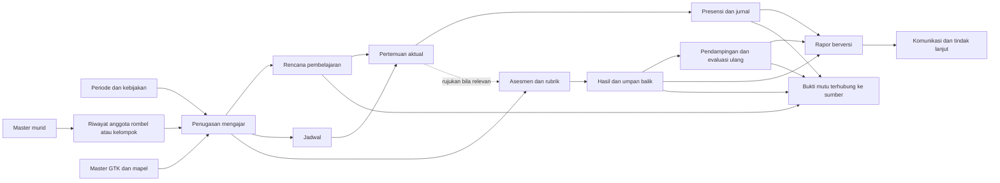
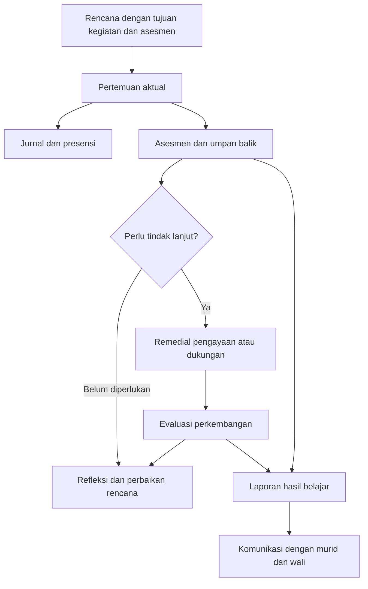

# Panduan dan Spesifikasi Kebutuhan Pengembangan Modul Akademik INFORA

| Identitas dokumen | Keterangan |
| --- | --- |
| Versi | 1.0 |
| Tanggal penyusunan | 27 November 2026 |
| Kedudukan | Panduan internal dan acuan rancangan pengembangan INFORA berbasis sumber resmi |
| Cakupan | SD, SMP, SMA, SMK, MI, MTs, dan MA; sekolah/madrasah negeri maupun swasta |
| Pengguna dokumen | Pimpinan sekolah/madrasah, pengelola kurikulum, guru, operator, tim mutu, analis sistem, pengembang, dan penguji |
| Acuan akreditasi | BAN-PDM, Kepmendikbudristek Nomor 246/O/2024, panduan penjelasan versi 2025, dan panduan pengajuan akreditasi ulang peningkatan mutu tahun 2026 |
| Hasil yang dituju | Layanan akademik yang terencana, terlaksana, dapat dievaluasi, serta memiliki bukti perbaikan yang dapat ditelusuri |

Dokumen ini disusun sebagai panduan formal internal untuk merancang modul akademik. Dokumen ini bukan peraturan atau dokumen yang diterbitkan/disahkan oleh BAN-PDM. Nama menu, model data, status, alur persetujuan, dan target teknis merupakan rancangan sistem; ketentuan yang berasal dari sumber resmi diberi rujukan.

## Daftar Isi

1. [Tujuan, cakupan, dan cara menggunakan panduan](#1-tujuan-cakupan-dan-cara-menggunakan-panduan)
2. [Dasar resmi dan implikasi akreditasi](#2-dasar-resmi-dan-implikasi-akreditasi)
3. [Hubungan dengan aplikasi INFORA yang ada](#3-hubungan-dengan-aplikasi-infora-yang-ada)
4. [Struktur dan katalog menu](#4-struktur-dan-katalog-menu)
5. [Peran, tanggung jawab, dan hak akses](#5-peran-tanggung-jawab-dan-hak-akses)
6. [Standar tampilan, formulir, dan konteks data](#6-standar-tampilan-formulir-dan-konteks-data)
7. [Spesifikasi setiap menu akademik](#7-spesifikasi-setiap-menu-akademik)
8. [Format data, dokumen, dan laporan](#8-format-data-dokumen-dan-laporan)
9. [Model data dan hubungan antarentitas](#9-model-data-dan-hubungan-antarentitas)
10. [Alur kerja menyeluruh dan status proses](#10-alur-kerja-menyeluruh-dan-status-proses)
11. [Aturan bisnis dan kasus khusus](#11-aturan-bisnis-dan-kasus-khusus)
12. [Kebutuhan menurut jenjang dan penyelenggara](#12-kebutuhan-menurut-jenjang-dan-penyelenggara)
13. [Pengelolaan mutu dan bukti akreditasi](#13-pengelolaan-mutu-dan-bukti-akreditasi)
14. [Hubungan lintas modul dan integrasi eksternal](#14-hubungan-lintas-modul-dan-integrasi-eksternal)
15. [Kebutuhan nonfungsional](#15-kebutuhan-nonfungsional)
16. [Ketentuan implementasi di proyek](#16-ketentuan-implementasi-di-proyek)
17. [Tahapan pengembangan dan ketergantungan](#17-tahapan-pengembangan-dan-ketergantungan)
18. [Kriteria penerimaan dan pengujian](#18-kriteria-penerimaan-dan-pengujian)
19. [Daftar periksa penyelesaian pengembangan](#19-daftar-periksa-penyelesaian-pengembangan)
20. [Sumber resmi dan pengelolaan perubahan](#20-sumber-resmi-dan-pengelolaan-perubahan)

## 1. Tujuan, Cakupan, dan Cara Menggunakan Panduan

### 1.1. Tujuan

Modul akademik harus membantu sekolah/madrasah menjalankan siklus berikut:

**Merencanakan pembelajaran → melaksanakan → menilai perkembangan → memberikan umpan balik dan pendampingan → mengevaluasi hasil → memperbaiki layanan.**

Tujuan pengembangan:

1. Menyatukan periode, kurikulum, rombel, penugasan guru, jadwal, pembelajaran, asesmen, dan rapor.
2. Memudahkan pekerjaan harian guru dan operator tanpa mengulang pencatatan identitas murid/guru.
3. Menjaga riwayat belajar dan keputusan akademik ketika murid berpindah kelas atau periode berganti.
4. Menyediakan informasi yang dapat digunakan untuk pendampingan murid dan pengembangan guru.
5. Menghasilkan dokumen dan bukti kinerja dari kegiatan yang benar-benar dilaksanakan.
6. Mendukung kebutuhan lintas jenjang melalui konfigurasi, termasuk kekhasan madrasah dan pendidikan vokasi.

### 1.2. Batas Modul

| Termasuk modul akademik | Terhubung melalui modul lain |
| --- | --- |
| Pengaturan akademik, kurikulum, kalender/jadwal, penugasan, pembelajaran, presensi pelajaran, asesmen, pendampingan, rapor, supervisi akademik | Identitas sekolah, GTK dan murid pada master bersama |
| Perkembangan belajar serta kontribusi kegiatan kokurikuler/ekstrakurikuler pada laporan akademik | Penyelenggaraan kegiatan dan prestasi yang telah dikelola di kesiswaan |
| Analisis kebutuhan pembelajaran, evaluasi program, dan rencana perbaikan akademik | Anggaran, sarpras, perpustakaan, kesehatan, BK, perlindungan murid, dan tata kelola |
| Penyediaan bukti akademik untuk penjaminan mutu | Pengelolaan akreditasi seluruh sekolah/madrasah melalui modul Mutu dan Akreditasi |

PPDB/SPMB, pembayaran/SPP, penggajian, pengadaan, dan pengelolaan perpustakaan tidak menjadi bagian inti modul akademik. Integrasi dilakukan pada data yang diperlukan oleh layanan belajar.

### 1.3. Arti Ketentuan dalam Dokumen

- **Ketentuan sumber resmi:** pernyataan yang dihubungkan ke sumber `[S-01]` sampai `[S-05]`; penerapannya mengikuti jenjang, mekanisme, dan versi sumber tersebut.
- **Wajib dalam rancangan:** kebutuhan minimum untuk memenuhi kontrak fungsi, integritas data, atau batas akses modul yang dibangun.
- **Dapat dikonfigurasi:** sekolah menetapkan nilai atau kebijakannya, dan sistem menyimpan versi serta masa berlakunya.
- **Tambahan sesuai jenjang:** fungsi diaktifkan hanya ketika relevan dengan jenis layanan pendidikan.

Kelengkapan menu atau jumlah berkas bukan ukuran peringkat akreditasi. Sistem mendukung penyelenggaraan layanan dan penyediaan bukti; penilaian akreditasi mengikuti instrumen dan mekanisme BAN-PDM.

## 2. Dasar Resmi dan Implikasi Akreditasi

### 2.1. Empat Area Kinerja

Kepmendikbudristek Nomor 246/O/2024 menetapkan instrumen menurut jenis/jenjang. Untuk sekolah/madrasah dalam cakupan dokumen ini, kerangka penilaiannya mencakup empat komponen. [S-01]

| Komponen | Area kinerja | Implikasi untuk sistem |
| --- | --- | --- |
| 1 | Kinerja Pendidik dalam Mengelola Proses Pembelajaran yang Berpusat pada Peserta Didik | Rencana, praktik pembelajaran, asesmen, umpan balik, dukungan murid, dan refleksi harus saling terhubung |
| 2 | Kepemimpinan Kepala Satuan Pendidikan dalam Pengelolaan Satuan Pendidikan | Sistem mendukung kurikulum, evaluasi, supervisi, partisipasi, dan perencanaan perbaikan berbasis data |
| 3 | Iklim Lingkungan Belajar | Akademik perlu terhubung dengan layanan inklusif, kebinekaan, keamanan psikis, keselamatan, dan kesehatan |
| 4 | Kompetensi Hasil Pembelajaran Lulusan dan/atau Peserta Didik | Perkembangan kompetensi dan informasi hasil layanan perlu memiliki sumber, periode, serta bukti yang jelas |

**Perbedaan mekanisme yang harus dipertahankan:**

1. Panduan rinci SD/MI, SMP/MTs, dan SMA/MA menjabarkan butir 1–14 dalam tiga komponen pertama. Instrumen menetapkan komponen hasil pembelajaran untuk jenjang tersebut diperhitungkan dari hasil analisis Asesmen Nasional. Nilai rapor internal tidak dapat menggantikan data AN. [S-01] [S-03]
2. SMK/MAK memiliki tambahan butir 15 tentang relevansi pembelajaran dengan dunia kerja serta butir 16 tentang kompetensi sesuai program keahlian. Portofolio/sertifikasi dan informasi kondisi lulusan mendapat perhatian khusus. [S-01] [S-04]
3. Panduan pengajuan akreditasi ulang peningkatan mutu tahun 2026 membahas mekanisme khusus pengusulan dan seleksi. Panduan tersebut tidak menggantikan keseluruhan instrumen IA2024. [S-05]

### 2.2. Bukti Kinerja yang Bermakna

Panduan BAN-PDM menggunakan telaah dokumen, wawancara, dan observasi untuk memahami kinerja layanan. Format dokumen tidak menjadi fokus penilaian; informasi dan praktik kinerjanya yang diperiksa. [S-02] [S-03]

Implikasi rancangan:

- Catatan harus menghubungkan tujuan, kegiatan yang terlaksana, hasil, tindak lanjut, dan evaluasi.
- Bukti dapat berupa rekam operasional, karya murid, laporan, dokumentasi, atau informasi lain yang relevan.
- Satu bukti dapat mendukung beberapa butir; tidak perlu menggandakan berkas untuk setiap butir.
- Catatan presensi mendukung informasi partisipasi, tetapi tidak menggantikan pengamatan mutu pembelajaran.
- Supervisi harus mencatat umpan balik dan tindak lanjut, bukan hanya jadwal atau berkas observasi.

### 2.3. Rapor Murid dan Rapor Pendidikan

| Objek | Isi dan fungsi | Penempatan dalam sistem |
| --- | --- | --- |
| Rapor murid | Perkembangan belajar individu, hasil asesmen, deskripsi, umpan balik, dan rekomendasi | Menu Rapor dan Keputusan Akademik |
| Rapor Pendidikan | Indikator mutu satuan pendidikan yang bersumber dari evaluasi sistem pendidikan | Bagian sumber data eksternal pada Evaluasi Mutu Akademik |
| Leger nilai | Rekap hasil penilaian per murid/mapel/periode sesuai kebijakan sekolah | Submenu Asesmen atau Rapor, memakai sumber hasil penilaian yang sama |

Panduan penjelasan 2025, indikator 1.3.4, menyebut pelaporan hasil belajar kepada murid dan orang tua minimum sekali per semester serta menekankan informasi perkembangan, umpan balik, dan pendampingan. Menu rapor perlu mencatat komunikasi dan tindak lanjutnya. [S-03, hlm. 50–51]

## 3. Hubungan dengan Aplikasi INFORA yang Ada

### 3.1. Dasar Pemeriksaan Proyek

Konteks berikut diperiksa dari struktur proyek, dokumentasi, daftar rute Artisan, dan paket terpasang pada 27 November 2026. Keberadaan rute menunjukkan titik integrasi tersedia, bukan bahwa seluruh kebutuhan baru telah diimplementasikan atau diuji.

| Aspek | Kondisi yang ditemukan | Konsekuensi pengembangan |
| --- | --- | --- |
| Perangkat pengembangan | PHP 8.4.25; Laravel 13.44.1; Pest 5.3.7; Pest Laravel Plugin 5.0.1 | Verifikasi API pada major version terpasang sebelum menulis implementasi |
| Spreadsheet | PHPSpreadsheet 5.12.0 dan `app/Services/SpreadsheetService.php` | Tinjau dan gunakan layanan yang ada untuk impor/ekspor yang sesuai |
| Master akademik | Sekolah, GTK, murid, tingkatan, jurusan, mapel, dan rombel | Gunakan identitas dan hubungan yang ada; jangan membuat master kedua |
| Periode dan kalender | Tahun ajaran, semester, dan kalender akademik memiliki rute | Perluas melalui kebutuhan baru, dengan mempertahankan arsip lama |
| Presensi awal | Rute pendaftaran wajah dan presensi murid tersedia; dokumentasi menjelaskan presensi masuk/pulang | Bedakan sumber presensi harian dari presensi per pelajaran |
| Navigasi dan izin | Modul/menu/submenu serta izin pengguna tersedia | Daftarkan menu pada mekanisme yang ada dan tambahkan batas objek/penugasan |
| Cakupan terdahulu | Dokumentasi lama banyak berfokus pada SMA/SMK/MA | SD/SMP/MI/MTs merupakan perluasan yang perlu diverifikasi pada referensi dan aturan domain |
| Konteks sekolah | Dokumentasi operasional menyebut satu sekolah per database | Pertahankan konteks sekolah dan otorisasi; tidak perlu membuat arsitektur banyak sekolah baru untuk tugas ini |

### 3.2. Titik Integrasi yang Telah Terdaftar

| Data/layanan | Nama rute yang telah ditemukan |
| --- | --- |
| Sekolah | `master.data-sekolah.index` |
| GTK | `master.data-gtk.index` |
| Murid | `master.data-murid.index` |
| Tingkatan | `master.data-tingkatan.index` |
| Jurusan/konsentrasi | `master.data-jurusan.index` |
| Mata pelajaran | `master.data-mapel.index` |
| Rombel | `rombel.kelas.index` |
| Tahun ajaran dan semester | `konfigurasi-sekolah.tahun-ajaran.index` |
| Kalender akademik | `konfigurasi-sekolah.kalender-akademik.index` |
| Presensi masuk/pulang | `absen_murid.index` |
| Izin pengguna | `sistem.user.index` |

Dokumentasi [DESIGN](../detail/DESIGN.md), [rincian fitur](../detail/README.md), dan [panduan komponen](COMPONENTS.md) tetap menjadi sumber konteks produk. Untuk kebutuhan akreditasi pada dokumen ini, gunakan sumber BAN-PDM pada Bagian 20; penyebutan BAN-SM/IASP dalam dokumen lama tidak dipakai sebagai pemetaan instrumen baru.

## 4. Struktur dan Katalog Menu

### 4.1. Hierarki Navigasi

Hierarki berikut adalah katalog fungsi. Submenu dapat diwujudkan sebagai halaman atau tab sesuai kebutuhan pengguna; tidak semuanya harus menambah tingkat sidebar.

```text
AKADEMIK
├── Dashboard Akademik
├── Pengaturan Akademik
│   ├── Tahun Ajaran dan Semester
│   ├── Profil Kurikulum dan Struktur Mapel
│   └── Kebijakan Penilaian dan Rapor
├── Kelas dan Penugasan Guru
│   ├── Rombel dan Anggota Kelas
│   ├── Wali Kelas
│   ├── Kelompok Belajar / Mapel Pilihan
│   └── Penugasan Mengajar
├── Kalender dan Jadwal
│   ├── Kalender Akademik
│   ├── Jadwal Pelajaran
│   └── Agenda Asesmen dan Kegiatan
├── Kurikulum dan Perencanaan Pembelajaran
│   ├── Kurikulum Satuan Pendidikan
│   ├── Tujuan dan Alur Pembelajaran
│   ├── Rencana Pembelajaran
│   └── Perangkat dan Bahan Ajar
├── Jurnal Pembelajaran
│   ├── Pertemuan dan Jurnal KBM
│   └── Refleksi dan Dokumentasi
├── Presensi
│   ├── Presensi Harian
│   ├── Presensi Pelajaran
│   └── Rekap dan Tindak Lanjut Kehadiran
├── Asesmen dan Portofolio
│   ├── Rencana Asesmen dan Rubrik
│   ├── Input Hasil dan Umpan Balik
│   ├── Portofolio Murid
│   └── Rekap / Leger Nilai
├── Pendampingan Belajar
│   ├── Identifikasi Kebutuhan
│   ├── Remedial dan Pengayaan
│   └── Evaluasi Perkembangan
├── Rapor dan Keputusan Akademik
│   ├── Penyusunan dan Pemeriksaan Rapor
│   ├── Penerbitan dan Revisi Rapor
│   ├── Komunikasi Hasil Belajar
│   └── Kenaikan Kelas dan Kelulusan
├── Kokurikuler, Ekstrakurikuler, dan Prestasi
│   ├── Program dan Peserta Kegiatan
│   ├── Pelaksanaan dan Perkembangan
│   └── Prestasi dan Karya
└── Supervisi dan Evaluasi Mutu Akademik
    ├── Supervisi dan Refleksi Guru
    ├── Evaluasi Kurikulum / Program
    ├── Indikator Mutu dan Rapor Pendidikan
    └── Rencana Perbaikan dan Evaluasi Dampak

VOKASI — aktif sesuai kebutuhan SMK/MAK
├── Program dan Konsentrasi Keahlian
├── Mitra Industri dan Praktisi
├── PKL dan Monitoring
├── Praktik / Pembelajaran Berbasis Industri
├── Uji dan Sertifikasi Kompetensi
└── BKK, Pembinaan Karier, dan Tracer Lulusan

MUTU DAN AKREDITASI — melayani seluruh modul sekolah
├── Profil Instrumen dan Riwayat Akreditasi
├── Dokumen Utama dan Bank Bukti
├── Pemetaan Bukti per Butir
├── Deskripsi Kinerja Asesi
├── Evaluasi Diri Pengusulan Reakreditasi
├── Peninjauan dan Paket Bukti
└── Temuan serta Tindak Lanjut
```

### 4.2. Katalog Menu dan Rute Target

Nama rute target berikut merupakan usulan registrasi, bukan pernyataan bahwa rute tersebut sudah tersedia. Titik integrasi lama tetap menggunakan nama rute pada Bagian 3.2.

| ID | Nama menu | Tujuan | Rute target utama / penggunaan kembali |
| --- | --- | --- | --- |
| AK-01 | Dashboard Akademik | Menyajikan agenda, perkembangan, dan pekerjaan yang perlu ditindaklanjuti | Usulan `akademik.dashboard.index` |
| AK-02 | Pengaturan Akademik | Menetapkan periode, struktur, dan kebijakan | Gunakan rute tahun ajaran; usulan `akademik.pengaturan.index` untuk konfigurasi tambahan |
| AK-03 | Kelas dan Penugasan Guru | Mengelola peserta layanan dan tanggung jawab guru | Gunakan rute rombel; usulan `akademik.penugasan-mengajar.index` |
| AK-04 | Kalender dan Jadwal | Mengatur waktu layanan dan mencegah bentrok | Gunakan rute kalender; usulan `akademik.jadwal-pelajaran.index` |
| AK-05 | Kurikulum dan Perencanaan Pembelajaran | Menghubungkan kurikulum, tujuan, kegiatan, dan asesmen | Usulan `akademik.perencanaan-pembelajaran.index` |
| AK-06 | Jurnal Pembelajaran | Mencatat pelaksanaan, kendala, dan refleksi | Usulan `akademik.jurnal-pembelajaran.index` |
| AK-07 | Presensi | Memantau partisipasi dan tindak lanjut | Gunakan presensi harian; usulan `akademik.presensi-pelajaran.index` |
| AK-08 | Asesmen dan Portofolio | Menilai dan mendokumentasikan perkembangan kompetensi | Usulan `akademik.asesmen.index` |
| AK-09 | Pendampingan Belajar | Menindaklanjuti kebutuhan murid | Usulan `akademik.pendampingan-belajar.index` |
| AK-10 | Rapor dan Keputusan Akademik | Melaporkan perkembangan dan mencatat keputusan | Usulan `akademik.rapor.index` |
| AK-11 | Kokurikuler, Ekstrakurikuler, dan Prestasi | Mencatat kontribusi kegiatan pada kompetensi/karakter | Usulan `akademik.kegiatan.index`; gunakan data kesiswaan bila tersedia |
| AK-12 | Supervisi dan Evaluasi Mutu Akademik | Mengevaluasi dan memperbaiki layanan | Usulan `akademik.evaluasi-mutu.index` |

Navigasi tahun ajaran, kalender, rombel, atau kegiatan dapat menjadi pintasan ke layanan yang sama. Pintasan tidak boleh menghasilkan tabel, formulir, atau proses pencatatan kedua untuk objek yang sama.

## 5. Peran, Tanggung Jawab, dan Hak Akses

### 5.1. Matriks Tanggung Jawab

Peran di bawah menggambarkan tugas operasional. Gunakan mekanisme akun, template izin, serta penugasan yang sudah ada; satu pengguna dapat mempunyai beberapa tugas.

| Peran | Lingkup data | Kewenangan utama | Batas penting |
| --- | --- | --- | --- |
| Admin/operator akademik | Sekolah dan periode yang menjadi kewenangannya | Master terkait, periode, rombel, anggota, penugasan, jadwal, impor administratif | Tidak otomatis berhak mengubah hasil penilaian atau mengesahkan rapor |
| Guru pengampu/guru kelas | Penugasan, kelompok belajar, mapel, dan tanggal yang berlaku | Rencana, jurnal, presensi pelajaran, hasil asesmen, umpan balik, pendampingan | Akses terhadap guru/mapel/kelas lain membutuhkan penugasan atau izin tambahan |
| Wali kelas | Rombel binaan dan periode berlaku | Rekap kelas, pemeriksaan rapor, rekomendasi, komunikasi dengan wali murid | Tidak otomatis mengubah nilai yang menjadi tanggung jawab guru lain |
| Pengelola kurikulum | Program akademik sekolah | Struktur kurikulum, koordinasi jadwal, peninjauan, supervisi, pemeriksaan kelengkapan | Pengesahan mengikuti mandat dan kebijakan sekolah |
| Kepala sekolah/madrasah | Layanan dan mutu sekolah | Evaluasi, pengesahan sesuai kebijakan, keputusan akademik, penugasan perbaikan | Perubahan dokumen terbit harus melalui proses revisi yang tercatat |
| Tim mutu/akreditasi | Bukti dan laporan yang diperlukan | Pemetaan bukti, DKA, evaluasi diri, peninjauan paket | Tidak mendapatkan seluruh catatan pribadi murid hanya karena menjadi tim akreditasi |
| Murid | Data diri dan kegiatan yang diikutinya | Melihat hasil yang dipublikasikan, menerima umpan balik, mengelola karya bila diaktifkan | Tidak melihat hasil atau catatan murid lain |
| Orang tua/wali | Anak yang hubungan kewaliannya terverifikasi | Rapor terbit, informasi perkembangan, komunikasi pendampingan | Portal merupakan pengembangan tambahan bila belum tersedia |
| Asesor/pihak peninjau eksternal | Paket bukti yang dipilih sekolah | Membaca bukti pada masa akses yang ditetapkan | Akses terkurasi dan tidak memberikan kewenangan ubah |
| Super Admin | Lingkup teknis sesuai mekanisme aplikasi saat ini | Pengelolaan sistem dan dukungan teknis | Aksi terhadap data akademik tetap memiliki riwayat; jangan mengubah mekanisme akses yang ada tanpa kebutuhan konkret |

### 5.2. Aturan Otorisasi

1. Periksa konteks sekolah, izin aksi, penugasan, tanggal berlaku, serta status objek pada sisi server.
2. Izin melihat menu tidak otomatis memberikan izin menerbitkan rapor, membuka periode, mengekspor data, atau melakukan koreksi nilai.
3. Tindakan khusus tersebut perlu kewenangan eksplisit pada mekanisme otorisasi yang ada.
4. Pergantian guru/wali kelas tidak mengubah identitas pembuat catatan sebelumnya.
5. Unduhan, pratinjau, pencarian, rekap, dan proses latar belakang menggunakan batas data yang sama dengan halaman utama.
6. Catatan BK, kesehatan, dan kebutuhan pendampingan dibagikan sesuai tugas; paket akreditasi menggunakan ringkasan atau bukti yang telah ditinjau.

## 6. Standar Tampilan, Formulir, dan Konteks Data

### 6.1. Konteks yang Harus Terlihat

Setiap halaman transaksi akademik menampilkan sekolah, tahun ajaran, semester bila relevan, serta kelas/kelompok/mapel yang dipilih. Pergantian filter tidak boleh memindahkan konteks dokumen yang sedang diedit secara diam-diam.

Pengguna dapat melihat arsip periode lama tanpa menjadikan periode tersebut aktif untuk transaksi baru.

### 6.2. Pola Halaman

| Jenis pekerjaan | Pola tampilan | Elemen minimum |
| --- | --- | --- |
| Master atau konfigurasi singkat | Daftar dengan formulir tambah/ubah mengikuti pola proyek | Pencarian, filter, status, validasi, aksi sesuai izin |
| Penugasan dan anggota kelas | Tabel hubungan dan masa berlaku | Guru/murid, rombel/kelompok, periode, tanggal berlaku, riwayat perubahan |
| Jadwal | Kalender atau matriks dengan daftar alternatif | Hari, jam, guru, kelompok, ruang, bentrok, masa berlaku |
| Jurnal/perencanaan | Formulir dengan bagian yang jelas | Tujuan, kegiatan, asesmen, sumber, refleksi, status simpan |
| Penilaian massal | Lembar hasil per murid | Identitas, status hasil, skor/deskripsi, umpan balik, simpan, kesalahan per baris |
| Pendampingan/supervisi | Detail kasus atau siklus perbaikan | Kondisi awal, tindakan, penanggung jawab, tenggat, hasil, tindak lanjut |
| Rapor | Daftar kelengkapan, pemeriksaan, dan pratinjau | Versi, sumber nilai, deskripsi, pengesahan, penerbitan, komunikasi |
| Analitik | Ringkasan dengan penelusuran sumber | Definisi indikator, periode, pembanding, jumlah peserta, kelengkapan data |

Gunakan komponen dan pola pada [COMPONENTS.md](COMPONENTS.md). Formulir kompleks disusun sesuai pekerjaan pengguna; jangan memaksakan seluruh alur rapor atau penilaian ke modal CRUD singkat.

### 6.3. Persyaratan Interaksi

- Pesan validasi menggunakan Bahasa Indonesia dan menunjuk isian yang perlu diperbaiki.
- Isian yang valid tetap tersedia setelah terjadi kesalahan.
- Draf tidak diperlakukan sebagai data yang sudah disahkan atau dipublikasikan.
- Penyimpanan massal menunjukkan jumlah baris tersimpan, gagal, dan belum diproses.
- Pengguna memperoleh penanda ketika data yang sedang diedit telah berubah oleh pengguna lain.
- Versi terbit, dokumen yang digantikan, dan dokumen yang masih draf dibedakan dengan jelas.
- Perangkat ponsel mendukung pekerjaan utama guru: presensi, jurnal, umpan balik, dan melihat tugas pendampingan.

## 7. Spesifikasi Setiap Menu Akademik

Semua ID `AK-*` berikut merupakan kebutuhan fungsional internal. Data umum dan aturan masa berlaku mengikuti Bagian 8–11.

### 7.1. AK-01 — Dashboard Akademik

**Tujuan:** membantu pengguna mengetahui agenda, kelengkapan pekerjaan, perkembangan murid, dan tindakan yang perlu dilakukan.

**Pengguna utama:** guru, wali kelas, pengelola kurikulum, dan pimpinan sesuai lingkup akses.

| Informasi | Sumber | Aturan penyajian |
| --- | --- | --- |
| Agenda hari ini | Jadwal, kalender, penugasan | Tampilkan kegiatan dan perubahan jadwal yang berlaku |
| Jurnal/presensi belum lengkap | Pertemuan dan catatan presensi | Bedakan belum diisi, dibatalkan, dan tidak perlu diisi |
| Asesmen dan rapor menunggu tindakan | Status asesmen dan rapor | Sediakan tautan langsung ke pekerjaan terkait |
| Murid memerlukan pendampingan | Asesmen, presensi, dan rencana pendampingan | Jelaskan alasan penandaan; jangan menyimpulkan diagnosis |
| Ringkasan perkembangan | Hasil belajar dan indikator mutu | Sertakan periode, sumber, dan kelengkapan data |

**Alur:** pilih konteks → baca ringkasan → buka catatan sumber → lakukan tindakan → ringkasan diperbarui.

**Keluaran:** agenda dan daftar tindak lanjut sesuai pengguna. Dashboard tidak menyimpan ulang nilai atau membuat versi lain dari presensi.

**Kriteria penerimaan:** jumlah pekerjaan dapat ditelusuri ke daftar sumber; pengguna tidak melihat kelas atau informasi murid di luar kewenangannya.

### 7.2. AK-02 — Pengaturan Akademik

**Tujuan:** menetapkan struktur dan kebijakan yang digunakan oleh seluruh proses akademik.

**Submenu:** tahun ajaran/semester; profil kurikulum; struktur mapel; kebijakan penilaian/rapor.

| Data | Format | Kebutuhan dan validasi |
| --- | --- | --- |
| Tahun ajaran dan semester | Referensi periode; tanggal mulai/akhir | Gunakan entitas yang ada; semester harus berada dalam tahun ajaran induknya |
| Jenjang dan profil kurikulum | Referensi, versi, masa berlaku | Wajib sesuai sekolah; istilah pembelajaran mengikuti profil |
| Struktur mapel | Mapel, tingkat/fase, kelompok, alokasi jam | Rujuk master mapel; mendukung mapel umum, pilihan, kekhasan madrasah, dan vokasi |
| Kebijakan asesmen | Skala/rubrik, aturan agregasi, pembulatan, kriteria capaian | Harus berversi; angka maupun deskripsi dapat digunakan sesuai kebijakan |
| Kebijakan rapor/keputusan | Template, alur pemeriksaan, penandatangan, ketentuan kenaikan/kelulusan | Penetapan oleh sekolah; tidak diasumsikan sama untuk semua jenjang |

**Alur:** siapkan periode → pilih profil → susun struktur → tetapkan kebijakan → periksa → aktifkan → simpan versi berlaku.

**Keluaran:** konfigurasi periode dan kebijakan yang dapat dirujuk transaksi.

**Kriteria penerimaan:** perubahan kebijakan baru tidak mengubah hasil atau rapor lama; istilah KKM, KKTP, CP/TP/ATP, silabus, dan kegiatan kokurikuler tidak dijadikan kewajiban universal.

### 7.3. AK-03 — Kelas dan Penugasan Guru

**Tujuan:** memastikan murid menerima layanan dalam kelompok yang tepat dan tanggung jawab guru jelas.

**Submenu:** rombel/anggota; wali kelas; kelompok belajar; penugasan mengajar.

| Data | Format | Kebutuhan dan validasi |
| --- | --- | --- |
| Rombel | Referensi rombel, tingkat, tahun ajaran | Gunakan master rombel; nama kelas boleh berulang pada periode berbeda |
| Keanggotaan murid | Murid, rombel/kelompok, tanggal mulai/akhir | Simpan riwayat; perubahan tidak menimpa keanggotaan lama |
| Kelompok belajar/mapel pilihan | Kode, tujuan, anggota, masa berlaku | Aktif ketika diperlukan; dapat menerima murid dari beberapa rombel |
| Wali kelas | GTK, rombel, masa berlaku | Kewenangan sesuai penugasan pada periode tersebut |
| Penugasan mengajar | GTK, mapel, rombel/kelompok, periode, alokasi jam, masa berlaku | Dasar akses rencana, jurnal, presensi pelajaran, dan asesmen |

**Alur:** siapkan rombel → tetapkan anggota → bentuk kelompok pilihan bila ada → tetapkan wali/guru → periksa masa berlaku dan beban → gunakan untuk jadwal.

**Keluaran:** daftar kelas, riwayat keanggotaan, daftar penugasan, dan bahan penyusunan dokumen pembagian tugas.

**Kriteria penerimaan:** murid yang pindah pada pertengahan semester tetap memiliki catatan pada kelas lama sebelum tanggal pindah; guru baru tidak menjadi pembuat catatan guru sebelumnya.

### 7.4. AK-04 — Kalender dan Jadwal

**Tujuan:** mengatur waktu pelaksanaan layanan dan mencegah bentrok sumber daya.

**Submenu:** kalender akademik; jadwal pelajaran; agenda asesmen/kegiatan.

| Data | Format | Kebutuhan dan validasi |
| --- | --- | --- |
| Agenda kalender | Jenis, judul, tanggal/jam, peserta, penanggung jawab | Gunakan kalender yang ada; agenda dapat berlangsung beberapa hari |
| Jadwal pelajaran | Penugasan, hari, jam mulai/akhir, ruang, masa berlaku | Jam mulai harus sebelum jam akhir; semua referensi berada pada konteks yang sesuai |
| Ruang/fasilitas | Referensi sarpras atau identitas ruang | Bentrok ruang diperiksa ketika ruang menjadi sumber daya terbatas |
| Perubahan jadwal | Jadwal asal, waktu pengganti, alasan | Simpan hubungan pembatalan atau penjadwalan ulang |
| Pengecualian | Libur, kegiatan khusus, jadwal blok | Tidak dibuat sebagai pertemuan terlaksana secara otomatis |

**Alur:** ambil penugasan → susun slot → periksa bentrok → tetapkan jadwal → terapkan kalender/pengecualian → sediakan agenda pertemuan.

**Keluaran:** jadwal per kelas/guru/ruang dan daftar perubahan.

**Kriteria penerimaan:** bentrok guru, kelompok/murid, atau ruang pada waktu dan masa berlaku yang sama ditolak dengan penjelasan. Slot yang hanya berbatasan pada jam akhir/mulai tidak dianggap bertumpang tindih.

### 7.5. AK-05 — Kurikulum dan Perencanaan Pembelajaran

**Tujuan:** menyelaraskan kurikulum, kebutuhan murid, tujuan, kegiatan, dan asesmen.

**Submenu:** KSP; tujuan/alur; rencana pembelajaran; perangkat/bahan ajar.

| Data | Format | Kebutuhan dan validasi |
| --- | --- | --- |
| KSP | Judul, versi, masa berlaku, dokumen/struktur, pengesahan | Rujukan kurikulum satuan pendidikan; dapat dievaluasi dan direvisi |
| Tujuan/alur | Kode internal, deskripsi, mapel, tingkat/fase, urutan | Nama dan struktur mengikuti profil kurikulum |
| Rencana pembelajaran | Penugasan, tujuan, kegiatan, asesmen, alokasi waktu | Tujuan–kegiatan–asesmen merupakan isi pokok; format tidak dikunci pada satu nama dokumen |
| Bahan ajar | Jenis, judul, berkas/tautan, pemilik, versi | Referensi yang digunakan saat pertemuan dapat ditelusuri |
| Penyesuaian pembelajaran | Kebutuhan belajar dan strategi dukungan | Isi sesuai kebutuhan layanan; akses terhadap informasi pribadi dibatasi |

**Alur:** pilih KSP/tujuan → guru susun rencana → peninjauan bila ditetapkan → simpan versi digunakan → hubungkan ke pertemuan → evaluasi dan revisi.

**Keluaran:** KSP, alur/tujuan, rencana pembelajaran, serta bahan ajar yang digunakan.

**Kriteria penerimaan:** pertemuan lama tetap merujuk versi rencana yang dipakai; sistem menerima format perencanaan yang berbeda selama isi pokoknya tersedia. [S-02, hlm. 20–21]

### 7.6. AK-06 — Jurnal Pembelajaran

**Tujuan:** mencatat praktik pembelajaran yang terlaksana beserta refleksinya.

**Submenu:** pertemuan/jurnal KBM; refleksi/dokumentasi.

| Data | Format | Kebutuhan dan validasi |
| --- | --- | --- |
| Pertemuan | Tanggal/jam aktual, penugasan, kelompok | Wajib sesuai layanan yang benar-benar dilaksanakan |
| Rencana/jadwal rujukan | Referensi dan versi | Dapat mencatat pengganti atau kegiatan di luar slot reguler dengan alasan |
| Pelaksanaan | Tujuan/materi, kegiatan, metode, bahan, pelaksana | Bedakan rencana dari kegiatan aktual |
| Kendala dan refleksi | Teks terstruktur, tindak lanjut | Memuat hal yang perlu diperbaiki atau dipertahankan |
| Dokumentasi | Berkas/tautan dan keterangannya | Lampiran hanya jika relevan; foto bukan syarat setiap pertemuan |

**Alur:** buka agenda → konfirmasi pelaksanaan → isi presensi/jurnal → catat refleksi → kaitkan asesmen/tindak lanjut → simpan.

**Keluaran:** jurnal per guru/mapel/kelas/periode dan rekam keterlaksanaan.

**Kriteria penerimaan:** pertemuan dibatalkan tidak masuk jumlah pembelajaran terlaksana; penjadwalan ulang terhubung ke pertemuan asal dan tidak dihitung dua kali.

### 7.7. AK-07 — Presensi

**Tujuan:** memantau partisipasi murid dan memberikan dasar tindak lanjut ketidakhadiran.

**Submenu:** presensi harian; presensi pelajaran; rekap/tindak lanjut.

| Data | Format | Kebutuhan dan validasi |
| --- | --- | --- |
| Lingkup presensi | Harian atau per pertemuan | Wajib dibedakan; data masuk/pulang tidak otomatis menjadi hadir pada semua pelajaran |
| Peserta | Murid dengan keanggotaan berlaku | Daftar peserta mengikuti tanggal hari/pertemuan |
| Status | Hadir, sakit, izin, alpa; belum diisi sebagai keadaan pencatatan | Belum diisi tidak otomatis alpa |
| Waktu dan keterlambatan | Waktu bila relevan; terlambat sebagai atribut terpisah | Murid terlambat tetap dapat mempunyai status hadir |
| Sumber/koreksi | Manual/kiosk/sumber lain, pencatat, alasan koreksi | Riwayat perubahan dan sumber tetap tersimpan |

**Alur:** pilih hari/pertemuan → muat peserta → catat/konfirmasi status → validasi → simpan → analisis pola → tindak lanjuti.

**Keluaran:** rekap harian/pelajaran, kelengkapan pencatatan, dan daftar tindak lanjut.

**Kriteria penerimaan:** rekap menggunakan hari/pertemuan yang relevan bagi murid; tidak menghitung hari libur, pertemuan batal, atau waktu sebelum murid bergabung sebagai ketidakhadiran.

### 7.8. AK-08 — Asesmen dan Portofolio

**Tujuan:** mengetahui perkembangan kompetensi dan memberikan umpan balik yang berguna.

**Submenu:** rencana/rubrik; hasil/umpan balik; portofolio; rekap/leger.

| Data | Format | Kebutuhan dan validasi |
| --- | --- | --- |
| Rencana asesmen | Tujuan, penugasan, peserta, jenis, teknik, tanggal | Mendukung asesmen awal, formatif, sumatif, praktik, observasi, proyek, dan teknik lain sesuai kebijakan |
| Skala/rubrik | Angka, tingkat capaian, deskripsi, kriteria | Berversi; tidak semua asesmen harus memiliki skor angka |
| Hasil per murid | Status hasil, skor/deskripsi, penilai | Nilai `0` sah; kosong, tidak hadir, belum dinilai, dan dibebaskan dibedakan |
| Umpan balik | Capaian, bagian yang perlu dikembangkan, saran | Dapat menjadi dasar pendampingan |
| Portofolio | Karya/bukti, tujuan, tanggal, pengakuan, pemilik | Terhubung ke murid dan konteks kompetensi; berkas tidak menjadi satu-satunya bentuk karya |
| Perhitungan nilai | Kebijakan versi, komponen, bobot bila dipakai | Formatif tidak otomatis wajib dibobotkan ke nilai akhir |

**Alur:** tetapkan tujuan/teknik → siapkan rubrik/peserta → laksanakan → nilai → beri umpan balik → publikasikan sesuai izin → tindak lanjuti → agregasi sesuai kebijakan.

**Keluaran:** hasil asesmen, umpan balik, portofolio, perkembangan kompetensi, dan leger.

**Kriteria penerimaan:** hasil dapat ditelusuri ke asesmen/rubrik; perhitungan tidak mengubah data belum lengkap menjadi nol dan tidak menghapus hasil awal setelah remedial.

### 7.9. AK-09 — Pendampingan Belajar

**Tujuan:** membantu murid berdasarkan kebutuhan nyata dan mengevaluasi hasil bantuan.

**Submenu:** identifikasi; remedial/pengayaan; evaluasi perkembangan.

| Data | Format | Kebutuhan dan validasi |
| --- | --- | --- |
| Dasar kebutuhan | Hasil asesmen, presensi, refleksi, atau pengamatan | Sumber awal dan tanggal identifikasi harus dapat ditelusuri |
| Tujuan pendampingan | Kompetensi/kebutuhan dan kondisi awal | Rumusan konkret sesuai kebutuhan murid |
| Kegiatan | Remedial, pengayaan, penyesuaian, pendampingan lain | Penanggung jawab, jadwal, strategi, dan peserta wajib jelas |
| Evaluasi ulang | Hasil, bukti, percobaan, tanggal | Simpan seluruh percobaan dan hasil awal |
| Tindak lanjut | Selesai, dilanjutkan, strategi diperbaiki, rujukan | Alasan berdasarkan hasil evaluasi; informasi rujukan sesuai kewenangan |

**Alur:** identifikasi → susun bantuan → laksanakan → evaluasi perkembangan → tentukan kelanjutan → hubungkan ke laporan hasil belajar.

**Keluaran:** riwayat bantuan dan perkembangan, rekomendasi, serta hasil perbaikan pembelajaran.

**Kriteria penerimaan:** catatan tidak hanya berisi “sudah remedial”; harus menunjukkan kondisi awal, tindakan, dan hasil. Penetapan nilai setelah remedial mengikuti kebijakan sekolah yang tersimpan.

### 7.10. AK-10 — Rapor dan Keputusan Akademik

**Tujuan:** melaporkan perkembangan murid, mengomunikasikan pendampingan, dan mencatat keputusan akademik secara terlacak.

**Submenu:** penyusunan/pemeriksaan; penerbitan/revisi; komunikasi; kenaikan/kelulusan.

| Data | Format | Kebutuhan dan validasi |
| --- | --- | --- |
| Rapor | Murid, periode, mapel, hasil/deskripsi, versi template | Sumber asesmen dan kebijakan perhitungan dapat ditelusuri |
| Informasi perkembangan | Capaian, rekomendasi, kegiatan, catatan wali kelas | Sesuai format sekolah; bukan angka nilai semata |
| Kelengkapan | Mapel wajib bagi murid, hasil, deskripsi, pemeriksaan | Mapel yang tidak diambil murid tidak dianggap nilai kosong yang wajib diisi |
| Pengesahan/penerbitan | Pihak berwenang, waktu, versi, dokumen | Simpan salinan data tetap saat terbit, termasuk identitas dan kebijakan yang digunakan |
| Komunikasi | Tanggal, penerima, cara, pembahasan, respons/tindak lanjut | Dukungan pelaporan minimum per semester sesuai panduan [S-03] |
| Keputusan akademik | Jenis, kebijakan, pertimbangan, hasil rapat, penetap | Keputusan kenaikan/kelulusan tidak ditetapkan dari rata-rata nilai tanpa aturan yang sah |

**Alur rapor:** lengkapi hasil → guru ajukan → wali/petugas periksa → perbaiki bila perlu → sahkan → terbitkan → komunikasikan → catat tindak lanjut.

**Alur revisi:** ajukan alasan → pihak berwenang memberi izin koreksi → perbaiki sumber → periksa/sahkan kembali → terbitkan versi pengganti → simpan versi terdahulu.

**Keluaran:** rapor, leger, riwayat komunikasi, keputusan, dan arsip versi.

**Kriteria penerimaan:** perubahan nama guru, mapel, kurikulum, atau kebijakan tidak mengubah rapor yang sudah terbit. Versi pengganti memiliki alasan, penetap, serta hubungan ke versi lama.

### 7.11. AK-11 — Kokurikuler, Ekstrakurikuler, dan Prestasi

**Tujuan:** mencatat pengalaman belajar yang mendukung kompetensi, karakter, minat, dan bakat.

**Submenu:** program/peserta; pelaksanaan/perkembangan; prestasi/karya.

| Data | Format | Kebutuhan dan validasi |
| --- | --- | --- |
| Jenis program | Kokurikuler, ekstrakurikuler, atau kegiatan lain yang relevan | Klasifikasi mengikuti kurikulum dan kebijakan; tidak disamakan dengan prestasi lomba |
| Tujuan dan periode | Kompetensi/karakter, rencana, tanggal | Menjadi dasar evaluasi program |
| Peserta/pembimbing | Referensi murid/GTK dan masa berlaku | Gunakan data kegiatan kesiswaan jika sudah tersedia |
| Pelaksanaan dan perkembangan | Agenda, partisipasi, karya, rubrik/deskripsi | Mendokumentasikan perkembangan peserta, bukan hanya daftar hadir |
| Prestasi | Individu/tim, penyelenggara, tanggal, tingkat, hasil, bukti | Kelompok/tim dapat mempunyai beberapa murid tanpa menggandakan objek prestasi |

**Alur:** susun program → tentukan peserta/pembimbing → laksanakan → catat karya/perkembangan → evaluasi → kirim ringkasan relevan ke rapor.

**Keluaran:** laporan kegiatan, perkembangan peserta, karya, dan prestasi.

**Kriteria penerimaan:** nama program seperti P5 atau istilah penggantinya dapat mengikuti kebijakan yang berlaku; prestasi beberapa murid tidak dianggap sebagai perkembangan semua murid.

### 7.12. AK-12 — Supervisi dan Evaluasi Mutu Akademik

**Tujuan:** memperbaiki praktik guru dan program akademik berdasarkan evaluasi yang dapat ditindaklanjuti.

**Submenu:** supervisi/refleksi; evaluasi kurikulum/program; indikator/Rapor Pendidikan; rencana perbaikan.

| Data | Format | Kebutuhan dan validasi |
| --- | --- | --- |
| Supervisi | Guru/pertemuan, observer, instrumen/versi, tanggal | Fokus observasi dan penanggung jawab jelas |
| Hasil dan refleksi | Temuan, kekuatan, umpan balik, respons guru | Terhubung ke praktik yang diamati |
| Evaluasi program | Program/kurikulum, periode, sumber, peserta evaluasi | Dapat menggunakan hasil kelas, refleksi, umpan balik murid/orang tua, dan data eksternal |
| Indikator mutu | Definisi, nilai, satuan, tahun, sumber, kelengkapan | Rapor Pendidikan/AN ditandai sebagai sumber eksternal, tidak dihitung ulang dari rapor lokal |
| Rencana perbaikan | Masalah, akar masalah, kegiatan, pemilik, tenggat, ukuran hasil | Dihubungkan ke pelaksanaan dan evaluasi dampak |
| Pengembangan guru | Kebutuhan kompetensi, kegiatan, penerapan, hasil | Terhubung dengan kepegawaian/pengembangan profesi bila tersedia |

**Alur:** kumpulkan sumber → observasi/evaluasi → refleksi → tentukan masalah → susun perbaikan → laksanakan → ukur hasil → perbaiki program berikutnya.

**Keluaran:** hasil supervisi, evaluasi program, rencana perbaikan, serta riwayat dampak antartahun.

**Kriteria penerimaan:** kegiatan selesai tidak otomatis berarti masalah teratasi; harus ada evaluasi hasil. Data internal dan eksternal dapat digunakan bersama dengan identitas sumber yang jelas. [S-03, hlm. 92–93]

## 8. Format Data, Dokumen, dan Laporan

### 8.1. Metadata dan Tipe Data Umum

Nama field berikut adalah rancangan logis. Penamaan fisik mengikuti skema dan konvensi proyek yang sudah ada.

| Field / informasi | Format | Ketentuan |
| --- | --- | --- |
| `id` | Identitas internal | Menjadi identitas hubungan; nama/kode tampilan tidak menggantikan ID |
| `school_id` | Referensi sekolah bila digunakan entitas | Ditentukan oleh konteks dan kewenangan server |
| `tahun_ajaran_id`, `semester_id` | Referensi periode | Wajib untuk transaksi periodik; semester boleh tidak relevan pada objek tahunan |
| Referensi guru/murid/mapel/kelas | ID master yang ada | Semua referensi diperiksa konteks, masa berlaku, dan aksesnya |
| Tanggal | Penyimpanan `YYYY-MM-DD` | Tampilan dapat `DD-MM-YYYY`; ekspor tidak menggunakan tanggal ambigu |
| Waktu | Jam lokal dan zona waktu sekolah; waktu kejadian lengkap bila diperlukan | Zona sekolah dapat WIB/WITA/WIT; penyimpanan dan tampilan konsisten |
| Identitas nasional/lokal | Teks | NIS/NISN/NISM/kode mempertahankan nol awal; validasi mengikuti jenis identitas yang ditetapkan |
| Angka penilaian | Desimal dengan presisi yang ditetapkan kebijakan | Hindari perubahan hasil karena pembulatan berulang |
| Status | Nilai terkontrol sesuai objek | Status proses berbeda dari status kehadiran atau status hasil asesmen |
| Pembuat/pengubah | Pengguna dan waktu | Aksi penting mencatat perubahan, alasan, dan versi |
| Versi | Nomor/identitas revisi | Wajib untuk kebijakan, rubrik, rencana yang dipakai, dan rapor terbit |
| Lampiran/tautan | Referensi berkas/URL, judul, tipe, ukuran, akses | Simpan lokasi aman dan keterangan relevansi |

### 8.2. Format Rencana Pembelajaran

Template berikut merupakan usulan internal yang dapat disesuaikan. BAN-PDM menekankan isi tujuan, kegiatan, dan asesmen, bukan satu format dokumen tertentu. [S-02, hlm. 21]

| Bagian | Isi minimum |
| --- | --- |
| Identitas | Sekolah, periode, guru, mapel, kelas/kelompok, tingkat/fase, versi |
| Dasar perencanaan | Kurikulum/tujuan yang dirujuk dan kebutuhan belajar murid |
| Tujuan | Kompetensi yang hendak dicapai dengan rumusan yang dapat dievaluasi |
| Kegiatan | Langkah pembelajaran, alokasi waktu, metode, sumber/bahan |
| Asesmen | Teknik, instrumen/rubrik, bukti yang diamati, cara memberikan umpan balik |
| Penyesuaian | Strategi dukungan atau pengayaan sesuai kebutuhan |
| Evaluasi rencana | Refleksi pelaksanaan dan perubahan untuk pembelajaran berikutnya |

### 8.3. Format Jurnal Pembelajaran

| Isian | Contoh data ilustratif |
| --- | --- |
| Periode | 2026/2027, semester ganjil |
| Penugasan | Guru pengampu Bahasa Indonesia, kelompok VIII-A |
| Pertemuan | 27-11-2026, 08.00–09.20 waktu sekolah |
| Tujuan | Mengidentifikasi gagasan utama teks |
| Kegiatan aktual | Membaca teks, diskusi kelompok, presentasi singkat |
| Asesmen/umpan balik | Hasil ringkas lembar kerja dan umpan balik per kelompok |
| Kendala | Sebagian murid belum dapat membedakan gagasan utama dan rincian |
| Tindak lanjut | Pendampingan kelompok kecil dan latihan teks berikutnya |
| Refleksi | Memperpendek teks awal dan memberi contoh tambahan |

Contoh ini bukan jadwal atau data sekolah nyata.

### 8.4. Format Hasil Asesmen

| Kolom | Isi | Aturan |
| --- | --- | --- |
| Murid | ID referensi dan identitas tampilan | Peserta asesmen yang sah |
| Status hasil | Dinilai / belum dinilai / tidak hadir / dibebaskan | Wajib; tidak disimpulkan hanya dari skor |
| Skor | Angka sesuai skala atau kosong | Angka `0` berbeda dari kosong; skor kosong sah untuk hasil deskriptif |
| Capaian/deskripsi | Hasil menurut tujuan/rubrik | Wajib ketika asesmen menggunakan deskripsi |
| Umpan balik | Kekuatan, kebutuhan pengembangan, saran | Dapat dikomunikasikan kepada murid |
| Bukti | Karya/observasi/tautan yang relevan | Sesuai teknik asesmen; tidak wajib berupa file untuk semua teknik |
| Percobaan | Nomor/identitas percobaan | Hasil awal dan evaluasi ulang tersimpan terpisah |

### 8.5. Format Rapor dan Leger

Template rapor mengikuti jenjang, kurikulum, dan ketentuan sekolah/Kemenag yang relevan. Format A4 dapat digunakan sebagai rancangan cetak awal; tidak diklaim sebagai satu-satunya format rapor resmi.

Isi minimum rancangan rapor:

1. Identitas sekolah, murid, kelas/kelompok, tahun ajaran, dan semester.
2. Mata pelajaran yang diambil, hasil menurut kebijakan, dan deskripsi perkembangan.
3. Ringkasan kegiatan/kompetensi yang relevan dengan format yang berlaku.
4. Ringkasan kehadiran dengan periode serta sumber rekap yang jelas.
5. Catatan wali kelas, umpan balik, dan rekomendasi pendampingan.
6. Pengesahan sesuai kebijakan dan informasi penerbitan/versi.
7. Keputusan akademik bila memang ditetapkan pada periode tersebut.

Leger menyajikan baris murid dan kolom mapel/komponen yang relevan, status kelengkapan, periode, versi kebijakan, serta waktu penyusunan. Leger tidak menjadi tempat menyimpan nilai akhir kedua yang tidak terhubung ke hasil asesmen.

### 8.6. Format Impor dan Ekspor

| Jenis | Format awal | Kebutuhan |
| --- | --- | --- |
| Impor administratif | XLSX melalui layanan spreadsheet yang ada; CSV bila didukung | Template berversi, identitas teks, pratinjau, kesalahan per baris, hasil proses |
| Impor hasil asesmen | XLSX/CSV sesuai implementasi | Konteks penugasan/asesmen ditetapkan, peserta diperiksa, skor/status dibedakan |
| Ekspor rekap/leger | XLSX atau CSV | Filter, identitas konteks, tanggal ekspor, versi, dan akses yang sesuai |
| Rapor/rencana/laporan | PDF setelah fasilitas ekspor yang sesuai tersedia | Pratinjau, konsistensi versi, tata letak, dan otorisasi unduh |
| Paket bukti | Manifest dan dokumen terpilih; ZIP bila fasilitas mendukung | Daftar sumber, versi, periode, butir, dan akses yang ditinjau |
| Video/dokumentasi besar | Tautan dengan metadata atau penyimpanan yang disepakati | Jangan mengasumsikan seluruh video harus diunggah ke aplikasi |

Contoh CSV hasil asesmen numerik, dengan ID/kode ilustratif:

```csv
kode_murid,kode_asesmen,status_hasil,skor,umpan_balik
"000123","ASM-001","dinilai",0,"Perlu pendampingan pada tujuan pertama"
"000124","ASM-001","belum_dinilai",,
```

Alur impor: unduh template → isi → unggah → validasi/pratinjau → konfirmasi simpan → proses → tampilkan hasil dan catatan kegagalan. Pemeriksaan wajib mencakup konteks sekolah, peserta, periode, izin, status kunci, duplikasi logis, dan rentang skor.

Kegagalan sebagian tidak boleh menghilangkan hasil lama. Kebijakan simpan seluruh berkas atau per kelompok baris harus jelas; hasil proses harus menunjukkan apa yang benar-benar tersimpan. Berkas spreadsheet yang diekspor memperlakukan isi teks sebagai teks, bukan formula yang berasal dari input pengguna.

### 8.7. Format Dokumen Mutu

| Dokumen | Format yang disediakan sistem | Pemilik data |
| --- | --- | --- |
| KSP | Dokumen versi yang disahkan, atau draf dari struktur yang tersedia | Kurikulum/pimpinan |
| RKT | Rencana masalah, program, pemilik, waktu, ukuran hasil; referensi ke dokumen pengelolaan | Tata kelola dengan kontribusi evaluasi akademik |
| RKAS / dokumen anggaran madrasah yang digunakan | Referensi dokumen resmi sekolah/madrasah dan kebutuhan akademik terkait | Keuangan/tata kelola |
| Kalender | Tampilan agenda dan ekspor periode | Pengelola kalender |
| DKA | Narasi per butir, rujukan bukti, versi panduan, penghitung karakter | Tim mutu dan penanggung jawab kinerja |
| Evaluasi diri pengusulan ulang | Template khusus peningkatan sejak visitasi terakhir | Pimpinan/tim mutu |

Nama dokumen anggaran mengikuti praktik resmi satuan pendidikan; aplikasi tidak memaksa madrasah memakai istilah sekolah jika dokumen yang digunakan berbeda.

## 9. Model Data dan Hubungan Antarentitas

### 9.1. Entitas Logis

Daftar ini adalah rancangan domain, bukan instruksi membuat tabel baru untuk seluruh baris. Gunakan dan perluas entitas yang tersedia setelah memeriksa skema.

| Entitas logis | Hubungan utama | Data yang dipertahankan |
| --- | --- | --- |
| Sekolah, GTK, Murid, Mapel, Tingkatan, Jurusan | Master bersama | Identitas dan status dari modul asal |
| Tahun Ajaran, Semester | Sekolah/periode induk | Rentang waktu, status aktif, penutupan |
| Profil Kurikulum dan Kebijakan | Sekolah, periode/masa berlaku | Versi, struktur, aturan penilaian dan rapor |
| Rombel | Tahun ajaran, tingkat | Identitas kelas periodik |
| Keanggotaan Rombel | Murid, rombel | Tanggal mulai/akhir dan alasan perubahan |
| Kelompok Belajar dan Anggota | Mapel/program, murid, periode | Peserta layanan lintas rombel bila diperlukan |
| Penugasan Mengajar/Wali | GTK, rombel/kelompok, mapel, periode | Masa berlaku, tanggung jawab, alokasi |
| Jadwal dan Pengecualian | Penugasan, ruang, kalender | Slot, masa berlaku, pembatalan/perubahan |
| KSP, Tujuan, Rencana, Bahan Ajar | Profil/versi, mapel, penugasan | Isi dan versi yang digunakan |
| Pertemuan dan Jurnal | Penugasan, jadwal/rencana | Waktu aktual, pelaksana, kegiatan, refleksi |
| Presensi Pelajaran | Pertemuan, murid | Status, sumber, koreksi |
| Asesmen dan Rubrik | Penugasan, tujuan, kebijakan | Jenis/teknik, peserta, kriteria, versi |
| Hasil Asesmen | Asesmen, murid, percobaan | Skor/deskripsi, status, penilai, umpan balik |
| Portofolio/Karya | Murid, tujuan/asesmen/program | Bukti kompetensi dan pengakuannya |
| Pendampingan dan Evaluasi | Murid/kelompok, dasar kebutuhan | Kondisi awal, tindakan, hasil ulang, tindak lanjut |
| Rapor dan Versi Rapor | Murid, periode, sumber hasil | Salinan data terbit, pengesahan, revisi |
| Komunikasi Hasil Belajar | Rapor/perkembangan, murid/wali | Pembahasan, respons, rekomendasi |
| Keputusan Akademik | Murid, periode, kebijakan | Pertimbangan, penetap, hasil rapat |
| Kegiatan dan Peserta | Program, murid/GTK, periode | Pelaksanaan dan perkembangan |
| Supervisi dan Refleksi | Guru, pertemuan/instrumen | Temuan, umpan balik, respons, rencana |
| Indikator dan Evaluasi Mutu | Periode, sumber, program | Definisi, nilai, kelengkapan, analisis |
| Rencana Perbaikan dan Evaluasi Dampak | Masalah, penanggung jawab | Kegiatan, tenggat, hasil, bukti |
| Instrumen/Butir Akreditasi | Jenjang, versi, sumber | Struktur dan masa penggunaan instrumen |
| Dokumen/Bukti dan Pemetaan | Objek sumber, butir, periode | Versi, bagian yang dirujuk, peninjauan |
| DKA/Evaluasi Diri | Sekolah, instrumen/mekanisme, periode | Narasi, versi format, bukti, status |
| Vokasi/PKL/Tracer | Program, murid/lulusan, mitra | Relasi dan data khusus pada Bagian 12.3 |

### 9.2. Hubungan Kunci



Hubungan pertemuan dan asesmen tidak wajib satu banding satu: asesmen dapat mencakup beberapa pertemuan atau kegiatan. Kebijakan penilaian mengatur sumber yang digunakan dalam rapor.

Satu bukti dapat dipetakan ke beberapa butir, dan satu butir dapat mempunyai beberapa bukti. Relasi pemetaan menyimpan bagian/halaman yang relevan tanpa menggandakan isi berkas.

## 10. Alur Kerja Menyeluruh dan Status Proses

### 10.1. Pembukaan Periode

1. Operator/pengelola menyiapkan tahun ajaran dan semester.
2. Sekolah menetapkan profil kurikulum, struktur mapel, dan kebijakan yang berlaku.
3. Operator menyiapkan rombel/riwayat anggota dan kelompok pilihan bila diperlukan.
4. Pihak berwenang menetapkan guru dan wali kelas.
5. Jadwal diperiksa terhadap waktu, guru, peserta, ruang, dan kalender.
6. Periode digunakan untuk transaksi setelah prasyarat inti tersedia.

Tidak perlu menahan aktivasi seluruh sekolah sampai setiap bahan ajar atau agenda sepanjang tahun selesai. Kelengkapan prasyarat ditetapkan sesuai fungsi yang akan digunakan.

### 10.2. Pembelajaran dan Pendampingan



### 10.3. Rapor dan Penutupan Periode

1. Sistem menampilkan kelengkapan berdasarkan mapel/program yang benar-benar diikuti murid.
2. Guru melengkapi hasil, deskripsi, dan rekomendasi sesuai kebijakan.
3. Wali/petugas memeriksa dan mengembalikan bagian yang perlu diperbaiki.
4. Pihak berwenang mengesahkan sesuai alur sekolah.
5. Sistem menerbitkan versi rapor dengan data dan kebijakan yang dibekukan untuk arsip.
6. Sekolah mengomunikasikan hasil dan mencatat tindak lanjut.
7. Kenaikan/kelulusan ditetapkan jika waktunya sesuai, dengan pertimbangan dan penetap tercatat.
8. Periode ditutup setelah transaksi yang perlu diselesaikan atau dikecualikan ditangani.
9. Keanggotaan periode berikutnya disiapkan sebagai catatan baru, bukan mengubah kelas pada seluruh arsip lama.

### 10.4. Siklus Perbaikan Mutu

Sumber internal/eksternal → identifikasi masalah → refleksi akar masalah → rencana perbaikan → pelaksanaan → evaluasi dampak → perbaikan program/kurikulum → pemetaan bukti.

Contoh: indikator membaca menunjukkan kebutuhan dukungan → sekolah merancang pendampingan → guru melaksanakan dan mencatat asesmen → perkembangan diperiksa → program diperbaiki → rangkaian sumber dihubungkan ke bukti kinerja.

### 10.5. Status yang Digunakan

| Objek | Status minimum | Aturan transisi |
| --- | --- | --- |
| Periode | Persiapan, aktif, ditutup | Pembukaan kembali mempunyai alasan, kewenangan, dan lingkup koreksi |
| Rencana | Draf, diajukan, perlu perbaikan, disetujui/digunakan, diarsipkan | Peninjauan dapat diaktifkan sesuai kebijakan; versi yang digunakan tidak hilang |
| Pertemuan | Direncanakan, terlaksana, dibatalkan, dijadwalkan ulang | Pembatalan dan penggantian memiliki hubungan serta alasan |
| Asesmen | Draf, siap, penilaian berlangsung, selesai, dipublikasikan, dikunci | Pengubahan setelah dikunci memerlukan koreksi yang sah |
| Pendampingan | Direncanakan, berjalan, dievaluasi, selesai/dilanjutkan | Selesai ditentukan dari evaluasi, bukan hanya tanggal berakhir |
| Rapor | Draf, diajukan, diperiksa, disahkan, diterbitkan | Penolakan/perbaikan kembali ke draf dengan catatan; versi lama dapat digantikan |
| Perbaikan mutu | Direncanakan, berjalan, dievaluasi, selesai/dilanjutkan | Simpan ukuran hasil dan evaluasi dampak |
| Bukti/DKA | Draf, ditinjau, siap digunakan, digantikan/diarsipkan | Status menunjukkan kesiapan internal, bukan penerimaan otomatis oleh BAN-PDM |

Status aktif periode dan status kunci dokumen adalah hal berbeda. Membuka periode tidak otomatis menghapus pengesahan atau membuka seluruh dokumen terbit. Aktivitas harian guru tidak semuanya memerlukan persetujuan kepala sekolah.

## 11. Aturan Bisnis dan Kasus Khusus

### 11.1. Masa Berlaku dan Riwayat

1. Tahun/semester baru tidak mengganti konteks data lama.
2. Keanggotaan, penugasan, kebijakan, dan jadwal memiliki masa berlaku.
3. Perpindahan murid menutup keanggotaan lama dan membuka yang baru; nilai/presensi sebelumnya tetap terkait layanan asal.
4. Penyesuaian hasil untuk murid pindahan menggunakan pencatatan asal, dasar pengakuan, dan pihak yang menetapkan; jangan membuat hasil lokal palsu untuk kegiatan yang tidak diikuti.
5. Penonaktifan guru, murid, mapel, atau rombel tidak menghapus riwayat akademik.
6. Rapor lintas perubahan kelas mengambil sumber yang sah pada periode murid tersebut dan mempertahankan konteks asalnya.

### 11.2. Jadwal dan Keanggotaan

- Bentrok terjadi ketika rentang waktu serta masa berlaku bertumpang tindih dan memakai guru, ruang, atau peserta yang sama.
- Periksa anggota kelompok pilihan, bukan hanya ID rombel, untuk mendeteksi satu murid berada pada dua layanan bersamaan.
- Jadwal blok/praktik dan pertemuan pengganti menggunakan prinsip bentrok yang sama.
- Penggabungan beberapa rombel didukung melalui kelompok layanan; jangan menggandakan pertemuan untuk memberi kesan kegiatan berbeda.

### 11.3. Presensi dan Penyebut Laporan

Rancangan indikator kehadiran harus menyebut definisinya. Contoh:

```text
Kehadiran pada catatan yang telah lengkap =
jumlah status hadir / jumlah catatan berstatus hadir, sakit, izin, atau alpa × 100%

Kelengkapan pencatatan =
jumlah catatan berstatus terisi / jumlah catatan presensi yang seharusnya tersedia × 100%
```

Kedua angka ditampilkan bersama agar data belum diisi tidak menyembunyikan ketidaklengkapan. Jumlah catatan yang seharusnya tersedia mempertimbangkan keanggotaan, kalender, dan pertemuan terlaksana. Bila sekolah memilih definisi lain, simpan definisi dan versinya. Penyebut nol ditampilkan sebagai “belum ada data yang relevan”, bukan persentase nol atau seratus.

### 11.4. Penilaian dan Remedial

1. Skor nol adalah hasil sah; data kosong tidak otomatis menjadi nol.
2. Asesmen deskriptif dapat memiliki status dinilai tanpa skor numerik.
3. Status tidak hadir atau dibebaskan tidak otomatis menentukan nilai; tindak lanjut mengikuti kebijakan.
4. Jika agregasi menggunakan bobot, bobot komponen yang menjadi dasar perhitungan harus sesuai kebijakan dan tervalidasi.
5. Data yang belum lengkap ditandai; jangan menormalkan ulang bobot secara diam-diam sehingga nilai terlihat final.
6. Aturan remedial, termasuk memilih percobaan terbaru, tertinggi, atau hasil lain, harus berversi dan menyimpan hasil awal.
7. Pembulatan dilakukan pada tahap yang ditentukan kebijakan dan dapat dijelaskan dari sumber.

Contoh perhitungan internal, hanya jika sekolah menetapkan dua komponen berbobot:

```text
Komponen A = 82, bobot 40%
Komponen B = 90, bobot 60%
Hasil sebelum pembulatan = 82 × 0,40 + 90 × 0,60 = 86,8
```

Contoh tersebut bukan rumus nilai rapor yang diwajibkan BAN-PDM. Asesmen formatif tidak otomatis harus menjadi komponen berbobot.

### 11.5. Koreksi dan Penyimpanan Bersamaan

- Perubahan hasil/presensi penting mencatat nilai lama, perubahan, pelaku, waktu, dan alasan sesuai objek.
- Penyimpanan dari tampilan versi lama harus terdeteksi agar tidak menimpa perubahan terbaru secara diam-diam.
- Penyimpanan ganda akibat klik ulang atau pengulangan proses impor tidak boleh menggandakan hasil logis.
- Gunakan transaksi dan pengendalian perubahan yang sesuai konvensi proyek untuk menjaga aturan ketika dua proses berjalan bersamaan.
- Hapus draf yang belum digunakan dapat diizinkan; catatan terbit atau master yang telah dipakai menggunakan penonaktifan, pembatalan, atau koreksi yang menjaga arsip.

## 12. Kebutuhan Menurut Jenjang dan Penyelenggara

### 12.1. Matriks Konfigurasi

| Aspek | SD/MI | SMP/MTs | SMA/MA | SMK/MAK |
| --- | --- | --- | --- | --- |
| Tingkat layanan | Mendukung kelas 1–6 | Mendukung kelas 7–9 | Mendukung kelas 10–12 | Mendukung lama program yang diselenggarakan, termasuk program lebih dari tiga tahun bila relevan |
| Pola guru | Guru kelas dan guru mapel | Guru mapel | Guru mapel/kelompok pilihan | Guru umum/kejuruan, pembimbing, praktisi sesuai program |
| Kelompok belajar | Sesuai program sekolah | Sesuai program sekolah | Mapel pilihan/lintas rombel bila digunakan | Program/konsentrasi dan kelompok praktik |
| Struktur kurikulum | Profil yang berlaku, termasuk kemampuan dasar | Profil yang berlaku | Profil yang berlaku serta pilihan layanan | Profil umum dan kejuruan sesuai program |
| Fase/istilah | Dapat dipakai sesuai kurikulum | Dapat dipakai sesuai kurikulum | Dapat dipakai sesuai kurikulum | Dapat dipakai sesuai kurikulum |
| Pendampingan | Perkembangan kemampuan dasar dan kebutuhan individu | Perkembangan kompetensi dan kebutuhan individu | Kompetensi, pilihan studi, dan persiapan lanjut | Kompetensi, kesiapan kerja/wirausaha/studi lanjut |
| Rapor | Template sesuai jenjang dan kurikulum | Template sesuai jenjang dan kurikulum | Template sesuai jenjang dan kurikulum | Template sesuai program dan kurikulum |
| Vokasi | Tidak menjadi fitur inti | Tidak menjadi fitur inti | Tidak menjadi fitur inti | Tambahan khusus yang dibahas di bawah |

Pemetaan fase, nama program, dan kriteria capaian disimpan sebagai konfigurasi berversi. Dokumen ini tidak menetapkan satu struktur kurikulum terbaru sebagai kewajiban seluruh sekolah.

### 12.2. Madrasah dan Sekolah Swasta

**Madrasah:**

- Dukung struktur mapel dan program keagamaan sesuai ketentuan Kemenag serta kebijakan madrasah.
- Nama mapel, kelompok, alokasi, format hasil, identitas murid, dan dokumen pelaporan mengikuti referensi yang ditetapkan; jangan mengunci struktur MA sebagai struktur MI/MTs.
- Simpan dasar kebijakan kurikulum yang digunakan dan masa berlakunya.
- Integrasi EMIS, EDM, e-RKAM, atau e-Rapor madrasah memerlukan pemeriksaan mekanisme resmi tersendiri. Sumber BAN-PDM pada dokumen ini tidak membuktikan adanya API layanan tersebut.

**Sekolah/madrasah swasta:**

- Swasta adalah status penyelenggara, bukan jenjang baru.
- Menu inti dan prinsip bukti mutu tetap digunakan.
- Program khas yayasan dapat ditambahkan dengan tujuan, peserta, jadwal, hasil, dan evaluasi yang jelas.
- Persetujuan yayasan hanya digunakan bila sesuai kewenangan yang benar-benar ditetapkan.
- Dokumen anggaran untuk sumber yayasan/non-BOSP tetap dapat dirujuk dari modul tata kelola; panduan asesi menjelaskan fungsi RKAS untuk pelaporan pemanfaatan sumber tersebut. [S-02, hlm. 20]

### 12.3. Tambahan SMK/MAK

Tambahan ini mengacu pada kebutuhan pendidikan vokasi dan panduan SMK/MAK versi 2025. Nama menu merupakan rancangan sistem. [S-04]

| ID / menu | Tujuan dan data minimum | Alur | Keluaran |
| --- | --- | --- | --- |
| VK-01 Program dan Konsentrasi Keahlian | Struktur program, profil kompetensi, masa berlaku, peserta, mapel/praktik | Tetapkan program → kaitkan kompetensi dan layanan → evaluasi relevansi | Profil program dan peta kompetensi |
| VK-02 Mitra Industri dan Praktisi | Mitra, bidang, kerja sama, masa berlaku, praktisi, kegiatan kontribusi | Identifikasi mitra → tetapkan kerja sama → jadwalkan kontribusi → evaluasi | Bukti keterlibatan dunia kerja dan tindak lanjut |
| VK-03 PKL dan Monitoring | Murid, lokasi/mitra, pembimbing sekolah/industri, tujuan, periode, jurnal, monitoring, asesmen | Persiapan → penempatan → pelaksanaan → monitoring → penilaian/refleksi → tindak lanjut | Laporan PKL, umpan balik pembimbing, bukti kompetensi |
| VK-04 Praktik / Pembelajaran Berbasis Industri | Kegiatan/proyek, standar kerja, K3, sumber daya, peserta, produk, rubrik | Rencanakan → siapkan keselamatan → praktik → nilai produk/proses → evaluasi | Portofolio produk/proyek dan penerapan budaya kerja |
| VK-05 Uji dan Sertifikasi Kompetensi | Kompetensi, penyelenggara/lembaga, skema, tanggal, hasil, bukti pengakuan/sertifikat | Siapkan peserta → laksanakan → verifikasi hasil → kaitkan ke portofolio | Hasil uji dan sertifikat yang dapat ditelusuri |
| VK-06 BKK, Pembinaan Karier, dan Tracer | Angkatan, lulusan, waktu penelusuran, status, kesesuaian bidang/minat, verifikasi, program karier | Siapkan data alumni → pembinaan → penelusuran → verifikasi → analisis → perbaiki program | Kondisi lulusan dan evaluasi relevansi layanan |

Aturan khusus:

1. PKL dan praktik memakai identitas murid yang sama serta terkait periode/program asal.
2. Data dari pembimbing industri mencatat pemberi informasi dan waktu; verifikasi oleh sekolah sesuai kebutuhan.
3. Portofolio dapat berisi karya, produk, proyek, pengakuan, atau sertifikat; tidak terbatas pada satu jenis sertifikasi.
4. Tracer mempunyai riwayat penelusuran, bukan satu status alumni yang ditimpa terus-menerus.
5. Panduan SMK membahas mekanisme tracer minimum tahunan dan kondisi lulusan selama tiga tahun terakhir; sistem mendukung pengamatan tersebut tanpa menghapus tahun sebelumnya. [S-04, hlm. 157–159]
6. Lulusan dapat bekerja sekaligus melanjutkan studi atau berwirausaha. Status boleh lebih dari satu; rekap gabungan memakai jumlah orang berbeda agar tidak menghitung satu lulusan dua kali.
7. Rekap mencantumkan jumlah lulusan, jumlah terhubung/terverifikasi, status belum diketahui, waktu pengamatan, dan kesesuaian bidang/minat secara terpisah.
8. Proporsi tracer merupakan informasi faktual, bukan prediksi otomatis peringkat akreditasi.

## 13. Pengelolaan Mutu dan Bukti Akreditasi

### 13.1. Pemetaan Butir ke Dukungan Sistem

Tabel ini merupakan rekomendasi dukungan sistem. Bukti dari modul akademik tetap dilengkapi informasi lintas modul, observasi, dan wawancara sesuai konteks. [S-01] [S-03] [S-04]

| Butir | Ringkasan area kinerja | Menu/sumber pendukung | Bukti yang dapat ditelusuri |
| --- | --- | --- | --- |
| 1 | Dukungan sosial emosional | AK-06, AK-09, layanan BK | Kebutuhan, tindakan pendampingan, umpan balik, perkembangan |
| 2 | Kelas aman dan nyaman | AK-03, AK-06, AK-12 | Kesepakatan kelas, praktik pengelolaan, catatan observasi |
| 3 | Pembelajaran efektif dan bermakna | AK-05–AK-10 | Tujuan–kegiatan–asesmen, umpan balik, tindak lanjut, pelaporan |
| 4 | Keimanan, kebangsaan, nalar, pemecahan masalah, kompetensi/karakter relevan | AK-05, AK-06, AK-08, AK-11 | Pembelajaran, kegiatan, karya, perkembangan kompetensi/karakter |
| 5 | Refleksi, evaluasi, pengembangan profesional | AK-12, kepegawaian | Supervisi, refleksi, program pengembangan, penerapan dan dampak |
| 6 | Layanan partisipatif dan kolaboratif | AK-10, AK-12, tata kelola | Umpan balik, evaluasi bersama, keputusan dan program perbaikan |
| 7 | Anggaran terencana, berbasis data, transparan/akuntabel | AK-12, keuangan/tata kelola | Kebutuhan akademik, RKT, dokumen anggaran, realisasi/evaluasi |
| 8 | Sarpras sesuai kebutuhan pembelajaran | AK-04–AK-06, sarpras | Identifikasi kebutuhan, pemanfaatan, pemeliharaan, dampak layanan |
| 9 | Pengembangan kurikulum satuan pendidikan | AK-02, AK-04, AK-05, AK-12 | KSP, struktur/tujuan, pengorganisasian, evaluasi dan revisi |
| 10 | Kebinekaan | AK-05, AK-06, AK-11, kesiswaan | Program, partisipasi, pengalaman dan suasana belajar |
| 11 | Lingkungan inklusif | AK-05, AK-09, BK/sarpras | Akomodasi, penyesuaian, dukungan, evaluasi akses belajar |
| 12 | Keamanan psikis | Kesiswaan, perlindungan murid, BK | Pencegahan, layanan bantuan, pelaksanaan dan tindak lanjut terkurasi |
| 13 | Keselamatan | Sarpras, keselamatan, kegiatan/praktik | Prosedur, kesiapsiagaan, simulasi, perbaikan kondisi |
| 14 | Kesehatan fisik dan mental | UKS/BK, AK-05, AK-11 | Program, edukasi, layanan, partisipasi dan evaluasi |
| 15 — SMK/MAK | Pembelajaran relevan dunia kerja | VK-02–VK-04, AK-05/AK-06 | Budaya kerja/K3, pembelajaran berbasis industri, kontribusi praktisi |
| 16 — SMK/MAK | Kompetensi sesuai program keahlian | AK-08, VK-05/VK-06 | Karya/sertifikat/pengakuan, kondisi lulusan, pembinaan karier |

Komponen hasil pembelajaran umum menyimpan rujukan data AN/ESP dan tahun sumbernya secara terpisah dari rekap nilai lokal. Jangan membuat skor komponen nasional dari tabel hasil asesmen kelas.

### 13.2. Dokumen Utama dan Bukti Pendukung

Panduan Asesi versi 2025 menyebut dokumen/dokumentasi utama berikut: KSP, RKT, RKAS, kalender akademik, contoh rencana pembelajaran, serta foto/video lingkungan belajar. Dokumen yang digunakan sekolah menjadi sumber, dengan perhatian pada informasi kinerja. [S-02, hlm. 19–21]

| Kategori | Kebutuhan sistem | Penggunaan |
| --- | --- | --- |
| Dokumen utama | Jenis, periode, versi, pengesahan, pemilik, berkas/tautan | Menyiapkan dokumen yang digunakan satuan pendidikan |
| Bukti pendukung | Catatan sumber, relevansi, lokasi, pemilik, masa bukti, akses | Mengidentifikasi dan menyiapkan bukti untuk dijelaskan saat visitasi |
| Rekam operasional | Tautan objek dan versi, konteks, pelaksana, hasil/tindak lanjut | Membantu penelusuran praktik yang benar-benar dilakukan |
| Paket bukti | Daftar pilihan, butir, periode, versi dan manifest | Memudahkan peninjauan internal atau akses terkurasi |

Bukti pendukung diidentifikasi dalam Sispena dan disiapkan saat visitasi; panduan tidak meminta seluruh bukti pendukung diunggah ke Sispena. Menyimpan bukti dalam INFORA adalah pilihan pengelolaan internal yang berbeda dari kewajiban unggah ke sistem BAN-PDM. [S-02, hlm. 15–16, 22]

### 13.3. Format Metadata Bukti

| Field | Isi minimum |
| --- | --- |
| Judul dan kategori | Nama bukti dan jenis dokumen/rekam |
| Periode kegiatan | Tahun, semester bila relevan, atau rentang tanggal |
| Pemilik/penanggung jawab | Unit dan pengguna yang mengetahui bukti |
| Sumber asli | Objek operasional, versi dokumen, lokasi berkas/tautan |
| Pemetaan | Instrumen, versi, jenjang, komponen, butir, bagian/halaman |
| Penjelasan relevansi | Kinerja apa yang ditunjukkan dan hubungan dengan hasil/tindak lanjut |
| Peninjauan | Peninjau, waktu, catatan, status kesiapan |
| Akses | Pihak yang dapat membaca dan versi yang dapat dibagikan |

Persentase bukti siap dapat dipakai sebagai indikator pekerjaan administratif jika definisinya jelas. Indikator tersebut tidak diberi label nilai atau prediksi peringkat akreditasi.

### 13.4. Deskripsi Kinerja Asesi

Panduan Asesi 2025 menyediakan DKA per butir dengan maksimum 1.000 karakter. Narasi dapat merujuk bagian dokumen utama atau bukti lain. [S-02, hlm. 22]

Rancangan fungsi DKA:

- Pilihan instrumen/versi, jenjang, dan butir.
- Narasi kinerja dan penghitung karakter sesuai versi panduan.
- Rujukan spesifik ke bukti, bagian/halaman, serta periode.
- Status draf, ditinjau, dan siap digunakan.
- Ekspor atau penyalinan narasi untuk pengisian Sispena setelah diperiksa pengguna.
- Riwayat revisi dan penanggung jawab; penyusunan bantuan dari data tidak dianggap fakta final sebelum ditinjau.

### 13.5. Evaluasi Diri Pengusulan Akreditasi Ulang

Template ini terpisah dari DKA. Format 1.1 panduan 2026 meminta narasi peningkatan sejak visitasi terakhir untuk tiga komponen: pendidik, pengelolaan/kepala satuan, dan lingkungan belajar. Tiap komponen maksimum satu halaman A4, spasi 1, ukuran font 12. [S-05, hlm. 6–7]

| Bagian template internal | Isi |
| --- | --- |
| Identitas | Nama lembaga, jenjang, NPSN, wilayah, status akreditasi, masa sertifikat |
| Kondisi sebelumnya | Kondisi saat/sejak visitasi terakhir dan sumber pembanding |
| Peningkatan yang terjadi | Perubahan kinerja signifikan yang dapat dijelaskan |
| Upaya perbaikan | Program, pelaksanaan, penanggung jawab, periode |
| Hasil | Perkembangan yang ditemukan beserta sumber dan kelengkapan data |
| Bukti | Rujukan terpilih yang memperkuat narasi |

Pratinjau ekspor perlu memeriksa batas halaman. Isi setiap komponen tidak boleh dipotong diam-diam untuk memenuhi format. Jadwal, kriteria pengusulan, dan format disimpan menurut tahun panduan; jangan menganggap jadwal tahun 2026 berlaku pada tahun berikutnya.

## 14. Hubungan Lintas Modul dan Integrasi Eksternal

### 14.1. Kontrak Data Lintas Modul

| Modul sumber/tujuan | Data yang dipertukarkan | Ketentuan |
| --- | --- | --- |
| Master sekolah/GTK/murid/mapel/rombel | Referensi identitas dan status | Akademik memakai sumber yang sama |
| Kesiswaan/kegiatan | Peserta, perkembangan, karya/prestasi | Hindari pencatatan kegiatan kedua |
| BK/layanan dukungan | Rekomendasi layanan yang diperlukan | Catatan pribadi tidak disalin ke semua laporan |
| Sarpras/perpustakaan | Ruang, fasilitas, pemanfaatan, kebutuhan | Menopang jadwal dan evaluasi layanan belajar |
| Kepegawaian | Pengembangan guru dan penugasan terkait | Hubungkan kebutuhan supervisi dengan pengembangan |
| Keuangan/tata kelola | RKT, anggaran, realisasi program | Akademik mengirim kebutuhan/hasil evaluasi, bukan mengambil alih buku keuangan |
| Mutu dan Akreditasi | Bukti, indikator, temuan, tindak lanjut | Pemetaan menunjuk sumber operasional |
| Vokasi | Program, praktik, PKL, portofolio, kondisi lulusan | Pertahankan hubungan ke murid dan layanan akademik asal |

### 14.2. Integrasi Eksternal

| Layanan | Kebutuhan yang mungkin relevan | Gerbang sebelum implementasi |
| --- | --- | --- |
| Dapodik | Pertukaran referensi/data sekolah yang sesuai | Verifikasi cakupan sekolah, format, akses, dan mekanisme resmi |
| EMIS | Referensi/pelaporan madrasah | Verifikasi ketentuan Kemenag dan mekanisme resmi |
| e-Rapor sekolah/madrasah | Pertukaran hasil atau laporan sesuai layanan | Verifikasi versi, struktur, dan kewenangan pertukaran |
| Rapor Pendidikan/AN | Indikator sekolah dan sumber evaluasi | Gunakan akses serta ekspor yang tersedia secara resmi |
| Sispena | Persiapan dokumen/narasi/bukti | Sediakan ekspor internal; sinkronisasi langsung hanya jika mekanisme resmi tersedia |

Tahap awal dapat memakai pencatatan sumber atau impor/ekspor terverifikasi. Setiap pertukaran menyimpan versi format, waktu, asal data, pemetaan identitas, hasil validasi, serta catatan konflik. Jangan menampilkan “sudah tersinkron” ketika sistem baru menghasilkan berkas ekspor.

Dokumen ini tidak menetapkan semua layanan tersebut memiliki API yang dapat digunakan INFORA. Perubahan dependensi atau mekanisme akses dilakukan melalui proses pengembangan proyek yang berlaku.

## 15. Kebutuhan Nonfungsional

Target berikut merupakan target awal rancangan internal, bukan ketentuan BAN-PDM atau hasil pengukuran aplikasi saat ini.

| ID | Kebutuhan | Kriteria awal |
| --- | --- | --- |
| NF-01 | Integritas sumber dan periode | Tidak ada perubahan konteks/arsip tanpa proses yang tercatat |
| NF-02 | Akses sesuai peran/objek | Pembatasan berlaku pada halaman, API bila ada, pencarian, ekspor, dan berkas |
| NF-03 | Riwayat dan versi | Penilaian penting, revisi rapor, kebijakan, dan pemetaan bukti dapat ditelusuri |
| NF-04 | Kemudahan penggunaan | Guru dapat menyelesaikan presensi/jurnal pada ponsel; kesalahan tidak menghapus isian valid |
| NF-05 | Aksesibilitas tampilan | Formulir berlabel, fokus keyboard terlihat, status tidak disampaikan hanya melalui warna |
| NF-06 | Kinerja interaktif | Target persentil ke-95 halaman daftar paling lama 3 detik dan simpan biasa 2 detik pada lingkungan uji yang disepakati |
| NF-07 | Proses besar | Ekspor/impor besar menunjukkan progres dan hasil; gunakan proses yang sesuai jika waktu melebihi batas interaksi |
| NF-08 | Kualitas laporan | Identitas, filter, sumber, versi, jumlah peserta, serta data belum lengkap tercantum |
| NF-09 | Penyimpanan lampiran | Validasi isi/tipe/ukuran, nama aman, akses terkendali; batas mengikuti fasilitas proyek dan jenis dokumen |
| NF-10 | Cadangan/pemulihan | Data dan berkas terkait termasuk dalam cadangan; hasil pemulihan mempertahankan versi dan hubungan |
| NF-11 | Portabilitas basis data | Mengikuti aturan MariaDB/MySQL/SQLite proyek dan tidak mengandalkan DDL khusus tanpa penanganan |
| NF-12 | Perubahan kebijakan | Versi instrumen, kurikulum, rubrik, dan template dapat berubah tanpa merusak data lama |

Dataset pengukuran awal yang disarankan: 3.000 murid, 200 GTK, 100 rombel, dan riwayat tiga tahun ajaran. Ukuran ini disesuaikan dengan kapasitas sekolah sasaran. Catat spesifikasi server, jaringan, pengguna bersamaan, dan volume transaksi saat menilai target; jangan mengklaim target tercapai tanpa pengukuran.

Format/ukuran lampiran perlu mengikuti konvensi unggah yang ada. Jika PDF, video, atau berkas besar membutuhkan kemampuan di luar fasilitas tersebut, dokumentasikan kebutuhan dan implementasikan melalui mekanisme yang sesuai; jangan menyamakan batas foto dengan semua jenis dokumen.

## 16. Ketentuan Implementasi di Proyek

### 16.1. Aturan yang Harus Diikuti

1. Baca [indeks aturan proyek](../.ai/rules/index.md) dan aturan sesuai path sebelum membuat/mengubah kode.
2. Ikuti struktur domain, pola controller, Form Request, model, dan UI yang telah digunakan; jangan memperkenalkan lapisan arsitektur baru tanpa kebutuhan nyata.
3. Gunakan konteks sekolah dan otorisasi yang ada, serta tambahkan pemeriksaan penugasan/objek sesuai kontrak fungsi.
4. Gunakan master dan layanan spreadsheet yang telah tersedia setelah memeriksa kecocokannya.
5. Nama rute daftar mengikuti konvensi `.index`; pemetaan menu baru memakai navigasi/izin yang ada.
6. Gunakan komponen pada [COMPONENTS.md](COMPONENTS.md) dan sistem desain proyek.
7. Periksa skema sebelum membuat migrasi. Daftar entitas pada dokumen ini tidak membuktikan kebutuhan tabel baru.
8. Ikuti [aturan migrasi](../.ai/rules/migrations.md) dan [aturan batasan unik](../.agents/rules/avoid-unique-constraints-on-entity-attributes.md): gunakan identitas dan indeks sesuai proyek, tanpa menambahkan constraint `unique` pada kolom bisnis yang dilarang aturan lokal.
9. Jaga ketunggalan logis hasil/presensi dan konsistensi proses melalui validasi lingkup, transaksi, serta pengendalian proses bersamaan yang diperlukan; pemeriksaan sebelum simpan saja tidak cukup ketika terjadi perlombaan proses.
10. Lindungi arsip dari penghapusan hubungan induk yang merusak riwayat; kebijakan relasi ditentukan menurut jenis data.
11. Jangan menambah dependensi tanpa persetujuan yang diperlukan aturan proyek. PDF, ZIP, dan proses besar menggunakan fasilitas yang tersedia atau kebutuhan yang telah ditinjau.
12. Verifikasi API Laravel/Pest/paket menurut versi terpasang dan gunakan dokumentasi yang sesuai. Contoh kode lama bukan bukti kompatibilitas.

### 16.2. Pengujian dan Penyelesaian Kode

- Gunakan Pest sesuai pola proyek untuk perubahan perilaku.
- Uji kontrak fungsi, keputusan penting, perhitungan, validasi, dan batas akses; hindari tes yang hanya menyalin susunan implementasi.
- Jalankan pengujian yang paling sempit dan relevan setelah implementasi berubah.
- Jika PHP diubah, jalankan formatter sesuai aturan proyek sebelum menyatakan perubahan siap.
- Keberadaan menu, placeholder, atau penanda progres tidak sama dengan fungsi selesai.

Penyusunan dokumen ini tidak mengimplementasikan menu, mengubah skema, atau menguji perilaku baru. Bagian ini merupakan ketentuan bagi pekerjaan pengembangan berikutnya.

## 17. Tahapan Pengembangan dan Ketergantungan

### 17.1. Peta Ketergantungan

```text
Master dan konteks sekolah
→ periode + profil kurikulum + kebijakan
→ rombel/anggota/kelompok + penugasan
→ jadwal dan perencanaan
→ pertemuan/jurnal/presensi + asesmen
→ pendampingan dan evaluasi ulang
→ rapor + komunikasi + keputusan
→ supervisi/evaluasi mutu dan pemetaan bukti
```

Supervisi, refleksi, dan pencatatan sumber mutu dapat dikembangkan bersamaan dengan alur harian. Pemetaan bukti membutuhkan sumber operasional yang sudah memiliki identitas dan riwayat yang memadai.

### 17.2. Tahap Pengembangan

| Tahap | Lingkup | Hasil yang harus dapat digunakan | Gerbang penyelesaian |
| --- | --- | --- | --- |
| 0 — Verifikasi fondasi | Audit master/periode, referensi semua jenjang, hubungan murid/GTK, akses, dan sumber presensi | Peta penggunaan kembali, kebutuhan perluasan, dan model data yang sesuai | Tidak menggandakan master; aturan cakupan dan riwayat terdefinisi |
| 1 — Struktur layanan | AK-02, AK-03, AK-04 dan dasar AK-05 | Periode, penugasan, kelompok, kurikulum, jadwal yang dapat digunakan | Masa berlaku, bentrok, dan izin lulus pemeriksaan |
| 2 — Pembelajaran dan tindak lanjut | AK-05–AK-09; ringkasan AK-01 | Guru dapat merencanakan, melaksanakan, menilai, dan mendampingi | Satu siklus nyata dapat ditelusuri tanpa pengisian ganda |
| 3 — Pelaporan | AK-10 dan hubungan AK-11 | Rapor diperiksa, disahkan, terbit, dikomunikasikan, serta dapat direvisi | Sumber nilai, snapshot, status, dan riwayat revisi terjaga |
| 4 — Perbaikan dan bukti | AK-12 dan modul Mutu/Akreditasi | Evaluasi, tindakan perbaikan, DKA, serta paket bukti terpilih | Pemetaan sesuai versi instrumen dan bukti menunjukkan proses/hasil |
| 5 — Kekhasan dan integrasi | Tambahan vokasi, format madrasah, integrasi eksternal yang tervalidasi | Layanan khusus sesuai sekolah sasaran | Mekanisme sumber/akses terverifikasi dan batas lingkup diuji |

Format dasar kurikulum/madrasah yang dibutuhkan sekolah sasaran harus disiapkan sejak Tahap 0–1, bukan ditunda sampai Tahap 5. Begitu pula mapel pilihan atau kelompok praktik yang menjadi layanan inti sekolah.

### 17.3. Paket Pekerjaan yang Dapat Ditinjau

Untuk setiap menu, pekerjaan pengembangan memuat:

1. ID kebutuhan dan pengguna yang dilayani.
2. Sumber data yang dipakai kembali serta perubahan skema jika diperlukan.
3. Formulir, tampilan daftar/detail, hasil/ekspor, dan pesan kesalahan.
4. Aturan bisnis, status, kewenangan, serta kasus khusus.
5. Alur berhasil dan alur gagal yang penting.
6. Pengujian serta bukti verifikasi yang relevan.
7. Keterbatasan yang masih ada dan hubungan ke tahap berikutnya.

## 18. Kriteria Penerimaan dan Pengujian

Tabel ini menjadi acuan skenario penerimaan. Pengujian otomatis mengikuti pola dan paket proyek; uji pengguna menilai pekerjaan nyata pada data ilustratif, bukan hanya keberadaan tombol.

| ID | Kebutuhan terkait | Skenario | Hasil yang diharapkan |
| --- | --- | --- | --- |
| UAT-01 | AK-02, AK-03 | Membuka periode baru | Arsip periode lama tetap pada kelas, kebijakan, dan sumber asal |
| UAT-02 | AK-02 | Mengubah kebijakan penilaian untuk periode berikutnya | Perhitungan/rapor terbit lama tidak berubah |
| UAT-03 | AK-03 | Murid pindah kelas di tengah semester | Catatan lama terjaga; peserta pertemuan mengikuti tanggal keanggotaan |
| UAT-04 | AK-03 | Guru pengampu diganti | Akses mengikuti penugasan; identitas penilai/pencatat lama tetap tersedia |
| UAT-05 | AK-03, AK-04 | Mapel pilihan mempunyai anggota lintas rombel | Peserta dapat dikelola tanpa menggandakan identitas murid |
| UAT-06 | AK-04 | Jadwal guru/ruang/peserta bertumpang tindih | Simpan ditolak dengan informasi bentrok yang jelas |
| UAT-07 | AK-04 | Jadwal berakhir tepat saat jadwal berikutnya dimulai | Tidak dianggap bentrok jika tidak ada tumpang tindih lain |
| UAT-08 | AK-05 | Rencana pembelajaran direvisi setelah digunakan | Pertemuan lama tetap merujuk versi yang dipakai |
| UAT-09 | AK-06, AK-07 | Pertemuan dibatalkan dan dijadwalkan ulang | Tidak dihitung dua kali dan tidak membuat alpa pada pertemuan batal |
| UAT-10 | AK-07 | Murid tercatat masuk melalui kiosk | Presensi pelajaran tidak otomatis hadir tanpa konfirmasi/sumber yang sah |
| UAT-11 | AK-07 | Sebagian presensi belum diisi | Kelengkapan terlihat; data kosong tidak berubah menjadi alpa |
| UAT-12 | AK-08 | Skor nol, kosong, dan hasil deskriptif disimpan | Masing-masing dipertahankan sesuai status dan teknik asesmen |
| UAT-13 | AK-08 | Salah satu komponen berbobot belum dinilai | Nilai belum lengkap ditandai; bobot tidak dinormalkan diam-diam |
| UAT-14 | AK-08 | Perhitungan contoh 82×40% + 90×60% | Hasil sebelum pembulatan 86,8 dan sumber perhitungan dapat dilihat |
| UAT-15 | AK-09 | Murid mengikuti remedial dua kali | Hasil awal dan semua percobaan tersimpan; nilai pilihan mengikuti kebijakan |
| UAT-16 | AK-10 | Rapor diterbitkan lalu nama mapel/guru diubah | Arsip rapor terbit tetap menampilkan data versi penerbitan |
| UAT-17 | AK-10 | Koreksi rapor terbit diajukan | Alasan/izin tercatat; versi pengganti diperiksa dan versi lama tidak hilang |
| UAT-18 | AK-10 | Murid tidak mengambil mapel pilihan tertentu | Mapel tersebut tidak dianggap hasil wajib yang belum lengkap |
| UAT-19 | AK-10 | Hasil belajar dikomunikasikan kepada wali | Tanggal, penerima, pembahasan, rekomendasi, dan tindak lanjut tersimpan |
| UAT-20 | AK-12 | Program selesai tanpa pengukuran dampak | Status evaluasi belum lengkap terlihat; masalah tidak otomatis dianggap teratasi |
| UAT-21 | AK-01, AK-12 | Laporan memakai data tidak lengkap atau penyebut nol | Sumber, kelengkapan, dan kondisi belum ada data ditampilkan dengan benar |
| UAT-22 | Semua transaksi | Pengguna meminta objek/ekspor di luar sekolah atau penugasannya | Akses ditolak; data tidak ikut tampil atau terunduh |
| UAT-23 | Impor, AK-08 | Berkas mempunyai peserta salah, skor salah, atau periode terkunci | Kesalahan teridentifikasi; hasil lama tidak tertimpa tanpa proses yang sah |
| UAT-24 | Semua transaksi | Dua pengguna menyimpan versi yang sama atau proses diulang | Konflik/ganda logis terkelola tanpa menimpa hasil terbaru diam-diam |
| UAT-25 | Bukti, DKA | Satu bukti dipakai untuk beberapa butir | Referensi/halaman dapat berbeda tanpa menggandakan berkas |
| UAT-26 | DKA | Narasi melebihi batas 1.000 karakter pada profil panduan 2025 | Pengguna mendapat penanda dan tidak mengekspor narasi final melampaui batas |
| UAT-27 | Evaluasi diri 2026 | Narasi satu komponen melebihi satu halaman pada format yang ditentukan | Pratinjau menunjukkan pelanggaran; tidak memotong isi diam-diam |
| UAT-28 | VK-06 | Lulusan bekerja sekaligus kuliah dan sebagian belum diketahui | Rekap gabungan tidak menghitung orang dua kali; cakupan/status tidak diketahui terlihat |
| UAT-29 | Arsip, NF-10 | Master dinonaktifkan atau cadangan dipulihkan | Arsip hasil/rapor/bukti dan hubungan berkasnya tetap dapat ditelusuri |
| UAT-30 | NF-04, NF-05 | Guru menggunakan ponsel atau navigasi keyboard | Pekerjaan utama dapat diselesaikan dan kesalahan dapat diperbaiki |

Skenario yang mempunyai risiko berbeda tetap diuji terpisah. Jangan menambah pengujian yang hanya memeriksa susunan tabel/kelas tanpa membuktikan perilaku yang dibutuhkan.

## 19. Daftar Periksa Penyelesaian Pengembangan

Daftar berikut digunakan untuk menilai pekerjaan implementasi mendatang, bukan menyatakan fitur sudah selesai saat panduan ini dibuat.

- [ ] Nama menu, submenu, pengguna, dan ID kebutuhan sudah disepakati pada lingkup rilis.
- [ ] Master yang dipakai kembali serta kebutuhan perluasan sudah diperiksa.
- [ ] Konteks sekolah, tahun, semester, penugasan, dan masa berlaku diterapkan.
- [ ] Formulir dan keluaran memenuhi format serta validasi yang ditetapkan.
- [ ] Status proses dan kewenangan aksi khusus diterapkan pada sisi server.
- [ ] Riwayat mutasi murid/guru tidak merusak data lama.
- [ ] Presensi harian dan pelajaran dibedakan serta kelengkapan rekap terlihat.
- [ ] Status hasil, skor nol, deskripsi, bobot, dan remedial ditangani benar.
- [ ] Rapor terbit, revisi, komunikasi, dan keputusan dapat ditelusuri.
- [ ] Kebutuhan madrasah/jenjang/vokasi dalam lingkup rilis berfungsi sesuai konfigurasi.
- [ ] Bukti menunjuk sumber, versi, periode, dan bagian yang relevan.
- [ ] DKA dan evaluasi diri memakai format serta mekanisme yang tepat.
- [ ] Laporan membedakan indikator administratif, nilai lokal, dan sumber AN/Rapor Pendidikan.
- [ ] Impor/ekspor, proses bersamaan, akses berkas, serta arsip diuji sesuai risiko.
- [ ] Komponen UI, arsitektur, migrasi, dan aturan proyek dipatuhi.
- [ ] Pengujian relevan lulus; formatter dijalankan jika PHP diubah.
- [ ] Target kinerja diuji pada kondisi yang tercatat jika termasuk lingkup rilis.
- [ ] Dokumentasi penggunaan dan keterbatasan rilis tersedia pada pekerjaan yang membutuhkannya.

## 20. Sumber Resmi dan Pengelolaan Perubahan

### 20.1. Daftar Sumber Primer

Sumber berikut ditelusuri melalui [halaman dokumen resmi BAN-PDM](https://ban-pdm.id/documents/j/panduan-akreditasi) dan bagian regulasinya. Nomor halaman di bawah adalah nomor tercetak dalam dokumen; pada panduan 2025/2026 halaman PDF biasanya satu lebih besar karena sampul.

| ID | Sumber resmi | Tahun/bagian yang digunakan | Penggunaan dalam panduan |
| --- | --- | --- | --- |
| [S-01] | Kepmendikbudristek Nomor 246/O/2024 tentang Instrumen Akreditasi PAUD, Pendidikan Dasar, dan Pendidikan Menengah | Ditetapkan 19 Juni 2024; Lampiran II–V, hlm. 6–13 | Komponen/butir menurut jenjang dan sumber hasil pembelajaran AN |
| [S-02] | Panduan Akreditasi untuk Satuan Pendidikan Dasar, Pendidikan Menengah, dan Program Pendidikan Kesetaraan, versi 2025 | Hlm. 7–8, 12–16, 19–22 | Prinsip pembuktian, hasil pembelajaran/ESP, dokumen utama, bukti pendukung, DKA |
| [S-03] | Panduan Penjelasan IA2024 versi 2025 untuk SD/MI, SMP/MTs, dan SMA/MA | Hlm. 8–11; komponen mulai hlm. 16, 68, 120; pelaporan hlm. 50–51; evaluasi hlm. 92–93 | Indikator dan contoh bukti, perencanaan/asesmen, komunikasi hasil, supervisi/evaluasi |
| [S-04] | Panduan Penjelasan IA2024 versi 2025 untuk SMK/MAK, Asesi | Butir 15 hlm. 143–151; komponen 4 hlm. 152; butir 16 hlm. 153–159 | Relevansi dunia kerja, budaya kerja/K3, praktisi, portofolio/sertifikasi dan tracer |
| [S-05] | Panduan Pengajuan Akreditasi Ulang bagi Sekolah/Madrasah dan Program Pendidikan Kesetaraan yang Menunjukkan Peningkatan Mutu | Mei 2026; mekanisme hlm. 2–5; Format 1.1 hlm. 6–7 | Pengusulan peningkatan mutu, narasi evaluasi diri, dan bukti sejak visitasi terakhir |

[S-01]: https://ban-pdm.id/documents/download/1720674890_81659f281e6bee599f2a.pdf
[S-02]: https://ban-pdm.id/documents/download/1756911475_02a67651b220740f28b9.pdf
[S-03]: https://ban-pdm.id/documents/download/1756890580_7aed8e14ada8b94fca13.pdf
[S-04]: https://ban-pdm.id/documents/download/1760361959_819fe74bbb57f26f989c.pdf
[S-05]: https://ban-pdm.id/documents/download/1779253891_0692da8bfb84f682ebf2.pdf

### 20.2. Pembaruan Panduan dan Konfigurasi

1. Periksa sumber resmi ketika instrumen, kurikulum, mekanisme pengusulan, atau format pelaporan berubah.
2. Catat dokumen sumber, tanggal, versi, jenjang, dan masa penggunaan.
3. Tinjau pemetaan butir, batas narasi, template, kebijakan, serta integrasi yang terdampak.
4. Terapkan konfigurasi baru untuk masa berlaku yang tepat tanpa menulis ulang arsip lama.
5. Catat perubahan panduan dan skenario penerimaan yang perlu diperbarui.

### 20.3. Riwayat Dokumen

| Versi | Tanggal | Perubahan |
| --- | --- | --- |
| 1.0 | 27 November 2026 | Panduan awal: 12 menu akademik, alur/data, lintas jenjang, vokasi, kebutuhan teknis, pemetaan akreditasi, dan kriteria penerimaan |
